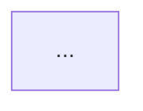

# Page shapes

Each page type has a shape. Use it as an order of parts, not as a form to fill: leave out a part that has
nothing to say. Headings below in `<angle brackets>` are placeholders for the real words.

## Feature page (user docs)

For a listener who wants to use a feature.

```md
---
title: AutoMix
description: Blend one song into the next on the beat, like a DJ.   ← what it does for you, one line
---

AutoMix blends the end of one song into the start of the next, on the beat.   ← what it does for you
It works on every client.                                                     ← clients, if not obvious

## Turn it on

In **Settings › Playback › Between songs**, set **AutoMix** to **Smooth** or **DJ**.

## <Options, each by its effect>

| Setting | Default | What changes |
|---|---|---|
| **AutoMix** | Off | **Smooth** keeps mixes short and subtle. **DJ** mixes over whole phrases. |

## When AutoMix does not mix               ← the limits, as a heading the reader would search for

- The songs are not measured yet. nori fades instead.
- ...

## What it costs                          ← battery, data, storage, a server it needs; leave out if nothing

[How AutoMix works](../how-it-works/automix.md) explains how nori plans a mix.   ← one level down
```

Rules for this shape:

- Describe each option by what the listener hears or sees, not by how it is built.
- Put the steps to turn it on before the details.
- Name the limits plainly. A reader who hits one should find it under a heading.

## How it works (user docs)

For a curious listener. It explains the idea, so a reader can predict what nori does.

```md
---
title: How AutoMix works
description: How nori measures songs and plans a mix between them.
---

<One sentence: the model of the whole thing.>
Before AutoMix can mix two songs, it measures each one on your device: its beats, its key, and where
the singing is.

```flow
Measure: beats, bars, key, loudness, vocals
-> once per song
Plan: where to start, how long, which effects
-> before the song ends
Mix: two songs, on the beat
```

## <The parts, in the order the data moves>

Short sections, each answering one question a curious reader asks:
"What does nori measure?", "Why does it wait for the last line?", "Why is my mix a fade?"

## Why it is built this way          ← the design choice and its reason, when it is not obvious

For the code, see [the player in the developer docs](https://github.com/norifm/nori/blob/master/docs/developers/...).
```

Rules for this shape:

- One diagram near the top, when the parts or the flow carry the idea.
- No setting tables: link to the feature page for those.
- Explain with what the listener knows (songs, beats, the phone's battery), not with type names.

## How-to (user or dev docs)

For a reader with a goal.

```md
---
title: Connect a server
description: Sign in to Navidrome, Subsonic or octo-fiesta.
---

To play your music, add your server as a profile. You need its address, your user name and your
password or API key.                                    ← goal and prerequisites, in the first lines

1. Open nori. On the first screen, tap **Navidrome or Subsonic**.
2. Enter the server's address, for example `https://music.example.com`.
3. Enter your user name and password, then tap **Connect**.

   nori shows your library.                             ← the result

   If nori says it cannot reach the server, check the address from your phone's browser.   ← recovery

## <Optional variations, each a heading>
```

Rules for this shape:

- One numbered list per task. One action per step. The location or condition comes first in the step.
- Show the result after the step that produces it.
- Put recovery right after the step that can fail, not in a separate troubleshooting page only.
- Offer the best way. Mention another way only when some readers cannot use the first.

## Reference (user or dev docs)

For a reader who looks one thing up.

- Mirror the product's own structure: the settings page by the app's groups, the manifest by its fields.
- Every entry has the same parts in the same order.
- Neutral and complete. No instructions, no advice. Link to the page that explains.
- Tables when entries share three or more attributes.

## Concept (developer docs)

For a contributor who needs the design before changing code. Follow matklad's ARCHITECTURE.md.

```md
# <The system>

<One paragraph: what the system does and the model that explains it.>



## The parts          ← a code map: each part, what it owns, where it is (paths in backticks)

## How a <request> moves through it   ← one real scenario, end to end, naming each part it crosses

## Rules that hold     ← invariants, written as plain statements: "Nothing on the audio path allocates."
                          Say what is absent: these cannot be seen by reading code.

## Where to change things   ← common changes and the files they touch

## Tests              ← how this part is tested, and the command
```

Rules for this shape:

- Name files, crates and types in backticks so readers can search for them. Do not link them.
- Describe what is unlikely to change. Leave line-by-line detail to the code and its comments.
- One concept per page. A page that grows past about 300 lines splits by topic.

## Tutorial (developer docs)

For a reader who learns by doing, for example a first plugin.

```md
# Build your first plugin

In this tutorial you build a plugin that <visible outcome>. It takes about 15 minutes.

You need: <tools, versions>.

## 1. <Step with a visible result>

<Command or code.>

<What you see now.>

## 2. ...

## Next steps          ← links to the reference and the concept pages
```

Rules for this shape:

- One path. No options, no alternatives.
- Every step ends with something the reader can see: output, a file, a row in the app.
- Explanation is one sentence at most, with a link to the concept page.

## README

A repository README is a front door, not a manual.

1. One sentence: what it is.
2. One picture or a short list of what it does.
3. How to get it (install or build), shortest path.
4. Links: user docs, developer docs, contributing, license.

A plugin README is shown on the plugin's page in the app. Write it for listeners: what the plugin adds,
what it needs (an account, a device), what it sends where. No build steps.
