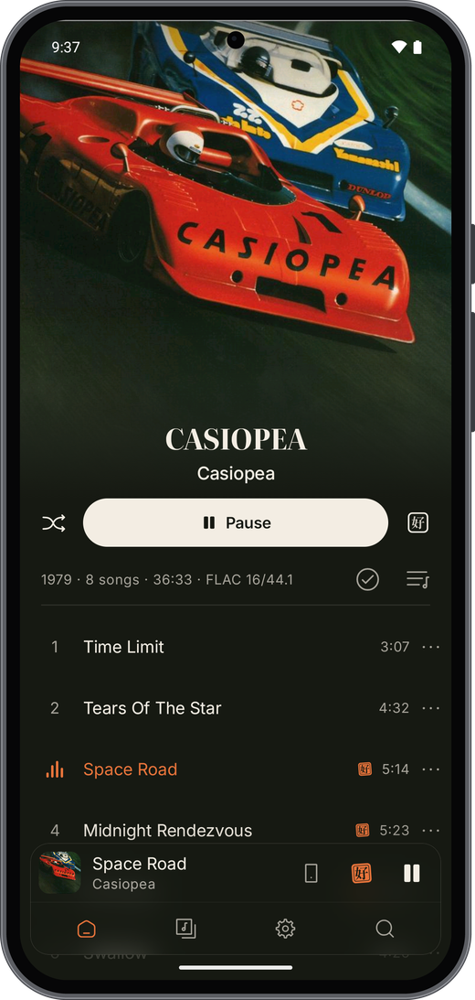
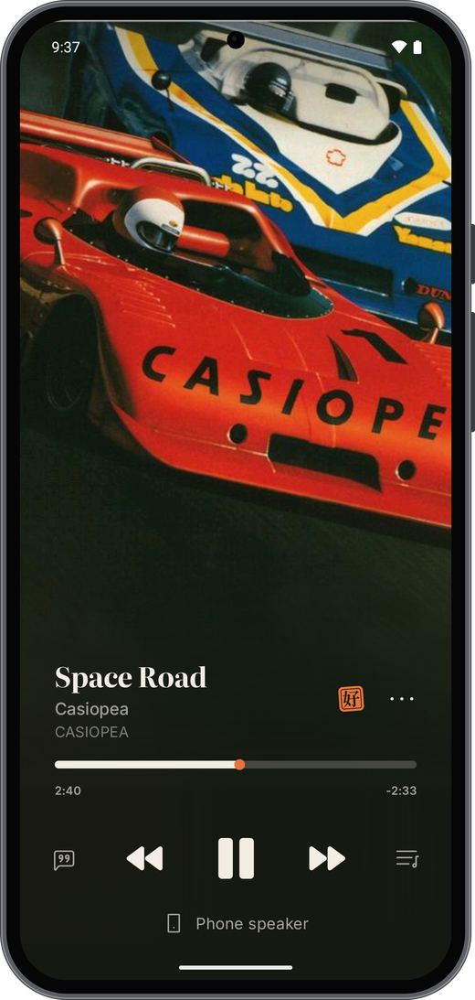

<p align="center">
  
</p>

<p align="center">
  A music player for your own Navidrome or Subsonic server, or YouTube Music, on Android, Linux, macOS,
  the terminal and the iPod touch.
</p>

<p align="center">
  <a href="https://github.com/norifm/nori/releases/latest"></a>
  
  <a href="LICENSE"></a>
</p>

<p align="center">
  &nbsp;
  
</p>

> nori is in active development: screens and settings change between versions. Bugs and ideas are
> welcome in [Issues](https://github.com/norifm/nori/issues).

- **Sleeps between bursts.** Music is decoded ahead and the CPU sleeps in between. Nothing ticks with
  the screen off, and on Android the audio chip can decode on its own.
- **Sounds right.** Gapless albums, AutoMix transitions on the beat, an equalizer with AutoEQ curves,
  and a sound profile for each output.
- **Finds the words.** Your server's lyrics and eleven online services, asked at once and timed
  against the singing, word by word where they have it.
- **Plays together.** Control one device from another, or host a jam that guests join with a link or
  QR code.
- **Grows with plugins.** Streaming services, new sounds and more, from nori's own repo or one you
  trust. Shape playback the way you like it.
- **One core, every screen.** One Rust core plays, queues and decides; each app only draws. Every app
  wears the same design, Nori Seasons.
- **Yours.** No nori account and no analytics. Connect your own server, and downloads play offline.

## Install

| client | get it |
|---|---|
| Android 8.0 or later | `nori-music-<version>.apk` from the [latest release](https://github.com/norifm/nori/releases/latest) |
| desktop and terminal, Linux and macOS, x86-64 and ARM64 | `.dmg`, `.deb`, AppImage, Flatpak or archive from the [latest release](https://github.com/norifm/nori/releases/latest); see the [install guide](https://norifm.com/docs/start/install/#desktop-and-terminal) |
| iPod touch 6th generation, iOS 12.2 or later, jailbroken | `nori-ipod-<version>.ipa` from the [latest release](https://github.com/norifm/nori/releases/latest); see the [iPod guide](https://norifm.com/docs/clients/ipod/) |

The [download picker](https://norifm.com/#download) on the website chooses the right file. A web client
is in development in `web/` and is not released yet.

## Links

[Website](https://norifm.com) · [Docs](https://norifm.com/docs/) · [Changelog](CHANGELOG.md) ·
[Contributing](CONTRIBUTING.md) · [Security](SECURITY.md)

## Build

```sh
cargo test -j4 --workspace                        # Rust tests, doctests included
cargo run --release -p nori-desktop               # the desktop client
cargo run --release -p nori-cli                   # the terminal client
tools/check.sh android -PrustTargets=arm64-v8a    # a debug Android APK
```

- Run Cargo with at most four jobs.
- Android needs the Android SDK and NDK, the Rust Android targets and `cargo-ndk`.
- The desktop on Debian or Ubuntu needs `pkg-config` and `libasound2-dev libfontconfig1-dev
  libfreetype6-dev libegl1-mesa-dev libgl1-mesa-dev libwayland-dev libxkbcommon-dev libx11-dev
  libwebkit2gtk-4.1-dev libgtk-3-dev`.
- More, including the optional Bazel backend: [Building](docs/developers/building.md).

## License

AGPL-3.0-or-later. You may use, change and sell nori, but whoever ships it or serves it over a network
must publish their source under the same license. See [LICENSE](LICENSE). Third-party licenses are in
[NOTICE](NOTICE) and in the app under Settings, About, Licenses.
