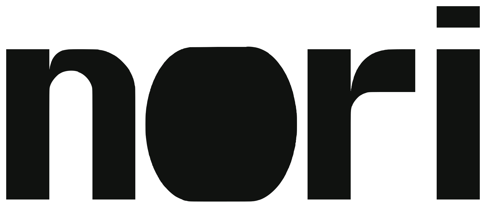
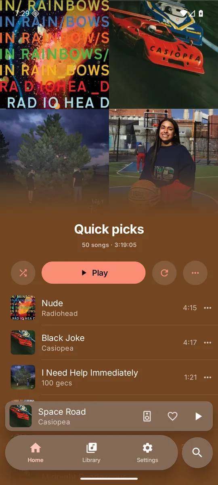
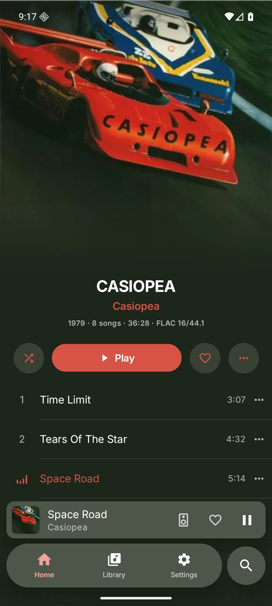
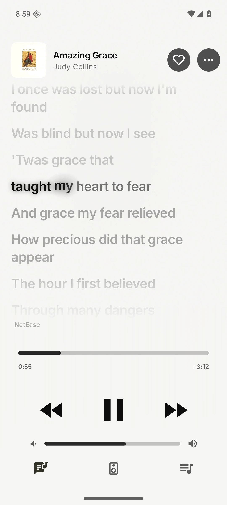

<p align="center">
  
</p>

<p align="center">
  A music player for your own Navidrome or Subsonic server, on Android, desktop, the terminal and the iPod touch.
</p>

<p align="center">
  <a href="https://github.com/norifm/nori/releases/latest"></a>
  
  <a href="LICENSE"></a>
</p>

<p align="center">
  &nbsp;
  &nbsp;
  
</p>

- **Sleeps between bursts.** Music is decoded ahead and the CPU sleeps in between; nothing ticks with the screen off.
- **Sounds right.** Gapless albums, AutoMix transitions on the beat, an equalizer with AutoEQ curves, a sound for each output.
- **Finds the words.** Your server's lyrics first, then lyrics services online, scored, word by word where they have it.
- **One core, every screen.** One Rust core plays, queues and decides; each app only draws.
- **Yours.** No nori account or analytics; connect your own server account, and downloads play offline.

## Install

- **Android**: the APK from the [latest release](https://github.com/norifm/nori/releases/latest), or see [norifm.com](https://norifm.com/#download).
- **Desktop and terminal**: Linux and macOS packages for ARM64 and x86-64 are in the [latest release](https://github.com/norifm/nori/releases/latest). Use the [download picker](https://norifm.com/#download) or follow the [installation guide](https://norifm.com/docs/start/install/#desktop-and-terminal).
- **iPod touch** (6th generation, iOS 12, jailbroken): the `.ipa` from the [latest release](https://github.com/norifm/nori/releases/latest), and the [iPod guide](https://norifm.com/docs/clients/ipod/).

## Links

[Website](https://norifm.com) · [Docs](https://norifm.com/docs/) · [Changelog](CHANGELOG.md) · [Contributing](CONTRIBUTING.md)

## Build

```sh
cargo test -j4 --workspace                            # Rust tests, including doctests
cargo run --release -p nori-desktop                   # the desktop client
cargo run --release -p nori-cli                       # the terminal client
tools/check.sh android -PrustTargets=arm64-v8a         # a debug Android APK
```

Android builds need the Android SDK, NDK, Rust Android targets, and `cargo-ndk`. Desktop builds need
the platform libraries listed in [Building](docs/site/developers/building.md). Cargo commands use Cargo;
the optional native Bazel backend is described there too. Run Cargo with at most four jobs.

## License

MIT. See [LICENSE](LICENSE); third-party licenses are in [NOTICE](NOTICE) and in the app under Settings, About, Licenses.
