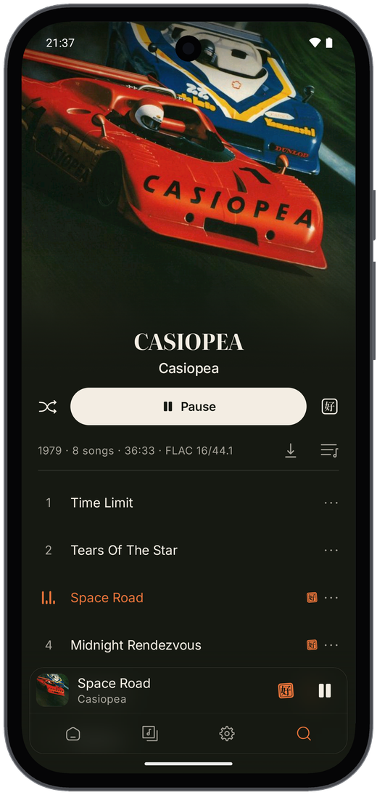

<p align="center">
  
</p>

<p align="center">
  A music player for your own Navidrome or Subsonic server, YouTube Music and SoundCloud, on Android
  phones and TVs, Windows, macOS, Linux, the terminal and the iPod touch.
</p>

<p align="center">
  <a href="https://github.com/norifm/nori/releases/latest"></a>
  
  <a href="LICENSE"></a>
</p>

<p align="center">
  &nbsp;
  
</p>

## What it does

- It saves battery. nori decodes music ahead and lets the CPU sleep in between. Nothing ticks while the
  screen is off, and on Android the audio chip can decode on its own.
- It sounds right: gapless albums, AutoMix transitions on the beat, an equalizer with AutoEQ curves,
  and a sound profile for each output.
- It finds the lyrics: your server's, and those of eleven online services, timed against the singing,
  word by word where a service has that.
- It plays together. Control one device from another, or host a jam that guests join with a link or a
  QR code.
- It grows with plugins. YouTube Music and SoundCloud fill your library with their albums, playlists and
  likes. Other plugins add battery and noise control for Soundcore and Sony headphones, new sounds, and
  AutoMix tuning, from nori's own repo or one you trust.
- It is yours. nori has no account and no analytics. Downloads play offline, and each profile can
  scrobble to ListenBrainz, Libre.fm or Last.fm.

One Rust core plays, queues and decides, and each app only draws. Every app has the same design, Nori
Seasons. nori is and always will be free. You can support it from **Settings** in the app.

## Install

Every file is on the [latest release](https://github.com/norifm/nori/releases/latest). The
[download page](https://norifm.com/#download) picks the right one for you.

| Platform | Requires | File |
|---|---|---|
| Android phones and Android TV | Android 8.0 or later | `nori-music-<version>-arm64-v8a.apk` |
| Windows | x86-64 | `nori-desktop-<version>-windows-x86_64.zip`, or `nori-cli-…` for the terminal app |
| macOS and Linux | x86-64 or ARM64 | `.dmg`, `.deb`, AppImage, Flatpak or an archive |
| iPod touch, 6th generation | iOS 12.2 or later, jailbroken | `nori-ipod-<version>.ipa` |

On Android, take `armeabi-v7a` for 32-bit phones and TV boxes, and `x86_64` for emulators and
Chromebooks. The [install guide](https://norifm.com/docs/start/install/#windows-macos-and-linux) covers
the desktop and terminal packages. The [iPod guide](https://norifm.com/docs/clients/ipod/) covers the
iPod. A web client is in development in `web/` and is not released yet.

## Build

```sh
cargo test -j4 --workspace                        # the Rust tests
cargo run --release -p nori-desktop               # the desktop app
cargo run --release -p nori-cli                   # the terminal app
tools/check.sh android -PrustTargets=arm64-v8a    # a debug Android APK
```

Run Cargo with at most four jobs. Each platform needs its own tools, such as the Android SDK and NDK,
or the system libraries of the desktop app. [Building](docs/developers/building.md) lists them.

## Docs

- [User docs](https://norifm.com/docs/), at norifm.com
- [Developer docs](docs/developers/README.md), in this repository
- [Contributing](CONTRIBUTING.md) and [Security](SECURITY.md)
- [Changelog](CHANGELOG.md) and [Issues](https://github.com/norifm/nori/issues)

## License

nori is AGPL-3.0-or-later. You may use, change and sell nori. Whoever ships it, or serves it over a
network, must publish their source under the same license. See [LICENSE](LICENSE). Third-party licenses
are in [NOTICE](NOTICE) and in the app, under **Settings › About › Licenses**.
