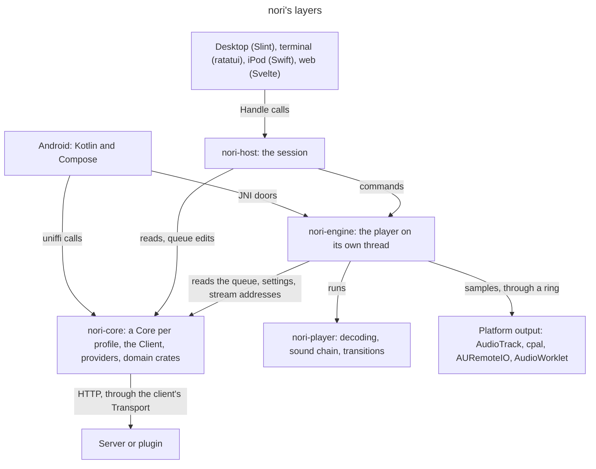
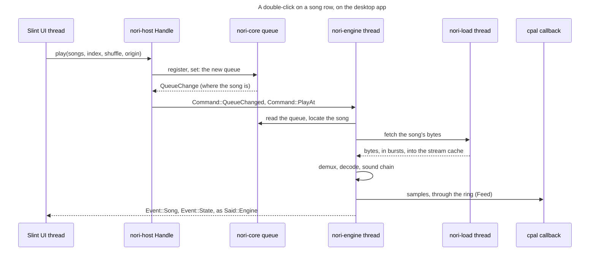
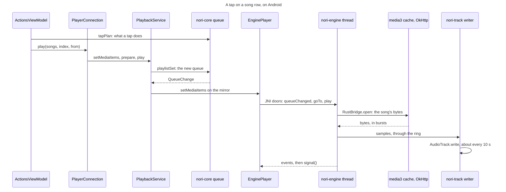

# Architecture

nori is one Rust core with a thin client for each platform. Every decision lives once, in Rust, and is
tested there. A client draws, holds the words, and wires the operating system: its audio output, HTTP
client, media controls and permissions. This page is for a contributor who needs the whole picture
before changing code. It covers every client.

Android calls the core and the engine directly from Kotlin. The desktop app, the terminal app, the iPod
app and the web client share `nori-host`, which holds the core and the engine for them. Android is
moving onto `nori-host` too.

## The parts

The crates fall into five groups. [AGENTS.md](../../AGENTS.md) lists every crate with one line each.

### The clients

| Client | Language | Where |
|---|---|---|
| Android | Kotlin, Compose | `android/app/` (UI), `android/core/` (service, no UI), `crates/android` |
| The desktop app | Rust, Slint | `crates/desktop`, `crates/desktop-ui` |
| The terminal app | Rust, ratatui | `crates/cli` |
| The iPod app | Swift, UIKit | `ios/`, `crates/ios` |
| The web client (in development) | Svelte, TypeScript | `web/`, `crates/web` |

On Android, `android/app/` is UI only: `vm/` holds the ViewModels and `ui/` the Compose screens.
`android/core/` is the library under it, with the media3 service (`playback/PlaybackService.kt`), the
engine's Kotlin side (`playback/RustPlayer.kt`), downloads, and the object graph (`Nori.kt`). It never
knows that a UI exists. `crates/android` builds the `norimusic` library: the uniffi scaffolding, the JNI
doors, and the AudioTrack writer (`track.rs`).

### The session: nori-host

`nori-host` (`crates/host`) is the session that every client but Android shares. One `Session` is one
open profile, and it owns that profile's `Core` and `Engine`. It saves the queue, runs remote control
and jams, syncs the offline index, and drives the system's media controls. Its `Handle` is what the client
calls. Its `Said` reports are what the client words. [Writing a client](writing-a-client.md) describes
it in full.

### The core: nori-core and the domain crates

`nori-core` (`crates/core`) holds a `Core` per server profile and the `Client` that talks to the
profile's source. The source is a provider: a Subsonic server, or a plugin's provider (see
[Providers](providers.md)). `crates/core/src/` keeps one file per domain, each with its `impl Core`
blocks.

`nori-core` re-exports the domain crates, so a client can depend on it alone:

- data: `nori-model` (records, `CoreError`, the log), `nori-db` (SQLite with FTS5), `nori-settings`
- network: `nori-net` (request signing, the `Transport` trait, stream cache keys)
- music: `nori-library` (browse, search, mixes, page layouts, menus), `nori-queue` (the played queue,
  autofill, scrobbling), `nori-transfers` (downloads), `nori-lyrics`
- sound and look: `nori-devices` (outputs, AutoEQ), `nori-automix`, `nori-covers`, `nori-look` (colors
  from covers, themes)
- the rest: `nori-remote` (remote control and jams), `nori-plugins` (the plugin host), `nori-backup`,
  `nori-perf`

`nori-tasks` says where async work runs: one thread per executor natively, the event loop in a
browser. `nori-time` is the one clock every crate reads, and tests move it by hand.

### The engine and the player

`nori-engine` (`crates/engine`) is the whole player on its own thread. It opens sources, fetches bytes,
demuxes, keeps the stream cache (`Store`), offloads, and fills the output ring. Its `core` feature plays
the core's queue (`CoreQueue`, `CoreLibrary`, `CoreApp` in `crates/engine/src/core.rs`).

`nori-player` (`crates/player`) is what the engine runs. It decodes, runs the sound chain, plans and
mixes AutoMix transitions, and keeps the queue's list and order. It does no I/O, so `pipeline.rs` and
`sim.rs` run it end to end on a simulated output. `nori-stretch` is its time stretch and pitch shift.

### Platform pieces in Rust

Some crates exist only for one platform:

- `nori-http`, `nori-output-cpal` and `nori-mpris` are the desktop's HTTP (ureq), sound card (cpal)
  and media controls.
- `nori-sign-in-window` shows a provider's sign-in page in the desktop's system web view.
- `nori-ios` puts `nori-host` behind a C ABI for the iPod app ([iPod internals](ipod-internals.md)).
- `nori-web` runs the core in a browser's Dedicated Worker, over `fetch`, played through an
  AudioWorklet.
- `nori-sink-protocol` is the frames between nori and a deep cast sink. It is `no_std`, for the sink's
  firmware.

## How playing a song moves through it

Playing a song takes two paths: one on Android, and one on every client over `nori-host`. Both end in
the same engine. The examples below play a song from an album page.

### On the desktop app

1. A double-click on a row in `crates/desktop-ui/ui/app.slint` calls the page's `song` callback.
   `App::song` in `crates/desktop/src/app.rs` calls `Handle::play` with the page's songs and the page
   it came from (`PageOrigin`).
2. `Handle::play_kept` in `crates/host/src/session.rs` checks two cases first. A jam guest sends the
   pick to the host (`jam_play`). While another device plays, the pick goes to that device.
3. Otherwise, the handle edits the core's queue: `queue::Session::register`, then `set`, which answers
   a `QueueChange`. It sends the engine `Command::QueueChanged` and schedules the queue save. Then
   `Engine::play_at` sends `Command::PlayAt` over a channel and wakes the `nori-engine` thread.
4. On its thread, the engine reads the queue through `CoreQueue` and locates the song through
   `CoreLibrary::locate`. A download opens as a file. Any other song opens through the stream cache.
5. If the cache does not hold the whole song, a `nori-load` thread fetches it. The bytes go through
   `nori_engine::core::resolving` (when the provider resolves addresses), the session's `Audio` (which
   refuses when offline), and `nori-http`. The loader writes into the stream cache, fills up to its high
   mark, closes the connection, and sleeps.
6. The engine demuxes with symphonia (`crates/engine/src/demux.rs`) and decodes with
   `nori_player::decode`. `nori_player::pipeline::Player` runs the transition engine and the sound
   chain. It writes the result into a lock-free ring (`RingTrack`) that holds 10 s.
7. cpal's callback thread pulls from the ring's `Feed`. When the ring drops below its low mark, the pull
   wakes the engine for its next burst.
8. The engine reports `Event::Song` and `Event::State`. The session passes them to the client as
   `Said::Engine`. The desktop app moves the report to its Slint event loop, and `App::follow` reads
   `Session::now` to draw the player.

### On Android

1. Tapping a row calls `ActionsViewModel.tap`. The ViewModel asks the core what a tap does
   (`tapPlan`). For `TapPlan.PLAY_LIST`, it calls `PlayerConnection.play`.
2. `PlayerConnection` is a media3 `MediaController` on `PlaybackService`. It calls `setMediaItems`,
   `prepare` and `play`.
3. In `PlaybackService`, the `Controls` player edits the core's queue first, with `playlistSet` over
   uniffi. The core answers a `QueueChange`. Then `Controls` passes the items on to `EnginePlayer` in
   `RustPlayer.kt`. That media3 player only mirrors the core's queue for the session.
4. `EnginePlayer` calls the engine through JNI doors: `queueChanged`, `goTo` and `play`. Each one sends
   a command over a channel and wakes the `nori-engine` thread.
5. The engine locates the song through `AndroidLibrary::locate` in `crates/android/src/player.rs`. A
   download, or a song already whole in the stream cache, opens as a file. Any other song opens
   through `JavaBytes`.
6. `JavaBytes` calls up into Kotlin (`RustBridge.open`). Kotlin opens the song through media3's
   `CacheDataSource`, over OkHttp. A `nori-load` thread reads the body in bursts. On Android, media3's
   cache is the stream cache, and the engine's own `Store` is not used.
7. The engine demuxes and decodes as on the desktop. HE-AAC decodes through MediaCodec
   (`crates/android/src/mediacodec.rs`). The sound chain writes into the ring.
8. The `nori-track` writer thread (`crates/android/src/track.rs`) holds an AudioTrack with room for a
   10 s burst and margin. It sleeps until 1 s is left, then moves the whole ring into the AudioTrack.
   That wakes the engine for its next burst, about once every ten seconds.
9. The engine's events go back through the `signal` up-call. `EnginePlayer` drains them on the main
   thread and updates its state. The media session and the notification follow. `PlayerConnection`
   publishes a `PlayerState` that the ViewModels read.

When offload is allowed, the engine skips decoding. It hands compressed packets to an offload
AudioTrack (`JavaOffload`) and can sleep for minutes. `nori_player::policy` allows offload only when
nothing touches the samples and no USB output is attached.

## Rules that hold

These rules hold everywhere. Some of them are absences, which code cannot show you.

- **Every decision lives once, in Rust.** A rule written in two languages is a bug. The clients are
  shells: Kotlin only decodes, outputs and asks.
- **The core returns no user-facing text.** It returns data and enums. Every word lives in a client:
  Android's `strings.xml` and `strings_ui.xml` (read through `ui/Say.kt`), `crates/desktop/src/words.rs`,
  `crates/cli/src/text.rs`, `ios/Sources/Say.swift` and `web/src/words.ts`. Logs, the perf report and
  the self test are English.
- **Calls across the boundary are coarse.** One call answers one response or one page. Per-buffer work
  uses raw JNI doors on direct buffers.
- **Nothing on the audio path allocates.** Steady playback makes no allocation on the engine's thread
  per buffer, or ever on the device's thread. The `no_alloc` tests count allocations in
  `crates/engine`, `crates/player`, `crates/look` and `crates/stretch`.
- **Playback runs in bursts.** The engine decodes about 10 s ahead and sleeps until the output wakes it.
  Nothing on the audio path wakes between bursts.
- **Nothing polls while music plays with the screen off.** The seek bar's timer runs only while the
  player screen shows. Media controls update on events, never on a timer.
- **An optional feature that is off costs nothing.** Every optional feature sits behind a setting. Off,
  it starts no thread, listener, socket or audio processor.
- **Anything that touches samples disables offload.** Offload never reaches a USB output.
- **The UI thread never waits for the core.** No FFI or network call runs in a constructor or while a
  screen draws.
- **The engine never fetches ahead a provider song the user did not ask for.** The next song is fetched
  whatever it is, because it plays anyway. Songs further ahead are never a provider's, because a stream
  request makes the server download them.
- **Entries are identified by index or sequence**, not by content ids.

## Where to change things

| Change | Where |
|---|---|
| How music plays or sounds | `crates/player`, `crates/engine` |
| What a session does: queue saving, autofill, remote control and jam rules | `crates/core`, `crates/host` |
| A setting | `StoredPrefs` in `crates/settings/src/settings.rs`, then each client's settings page |
| A page's layout or a menu | `nori-library`: `pages`, `rows`, `menus` |
| A provider | `crates/core/src/providers/` ([Providers](providers.md)) |
| A plugin extension point | `wit/plugin.wit` and `crates/plugins` ([The plugin host](plugin-host.md)) |
| A sound stage from a plugin | `crates/player/src/stage.rs` |
| A JNI door | `crates/android/src/lib.rs` and the Kotlin `external fun` |
| Words | Each client's words file, listed under [Rules that hold](#rules-that-hold) |
| A new crate | Its row in `AGENTS.md`, checked by `crates/testdir/tests/agents_map.rs` |

A new setting is one `StoredPrefs` field with its `#[setting(...)]` line. `settings_pages`
(`crates/settings/src/settings_pages.rs`) places it on a page for every client. Then each client words
it: Android in `vm/SettingsPages.kt` and `strings.xml`, the terminal app in
`crates/cli/src/settings_view.rs`, the desktop app in `crates/desktop/src/settings.rs`.
`crates/settings/tests/stored_format.rs` guards the stored format.

A new core crate also goes into the list in `crates/android/build.rs`, the dependencies of
`nori-android`, and the `ffi` feature of `nori-core`. If it exports an interface, it also goes into the
binding inputs in `android/core/build.gradle.kts`.

A JNI door is registered with `RegisterNatives`, never exported by a `Java_` name. A door with only
primitives is `@CriticalNative`. A short door over arrays or buffers is `@FastNative`. The Kotlin
`external fun` and the Rust function must agree.

## Tests

Behavior that Rust owns is tested in Rust, on the virtual clock where time matters. Device checks
cover only the Android glue: AudioTrack, MediaCodec, media3, the session, focus, routing and JNI.
`cargo test -p nori-player --test pipeline` runs the player end to end on a virtual clock.
[Testing](testing.md) has the test tiers and the commands.
