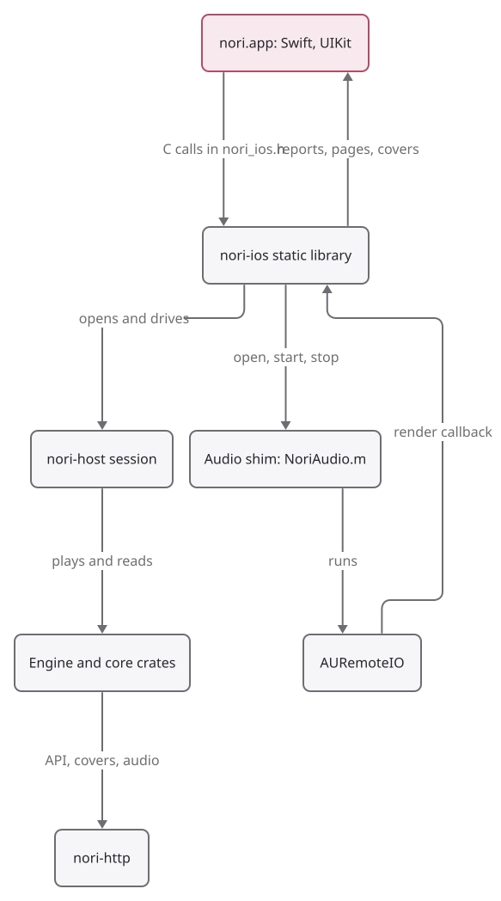
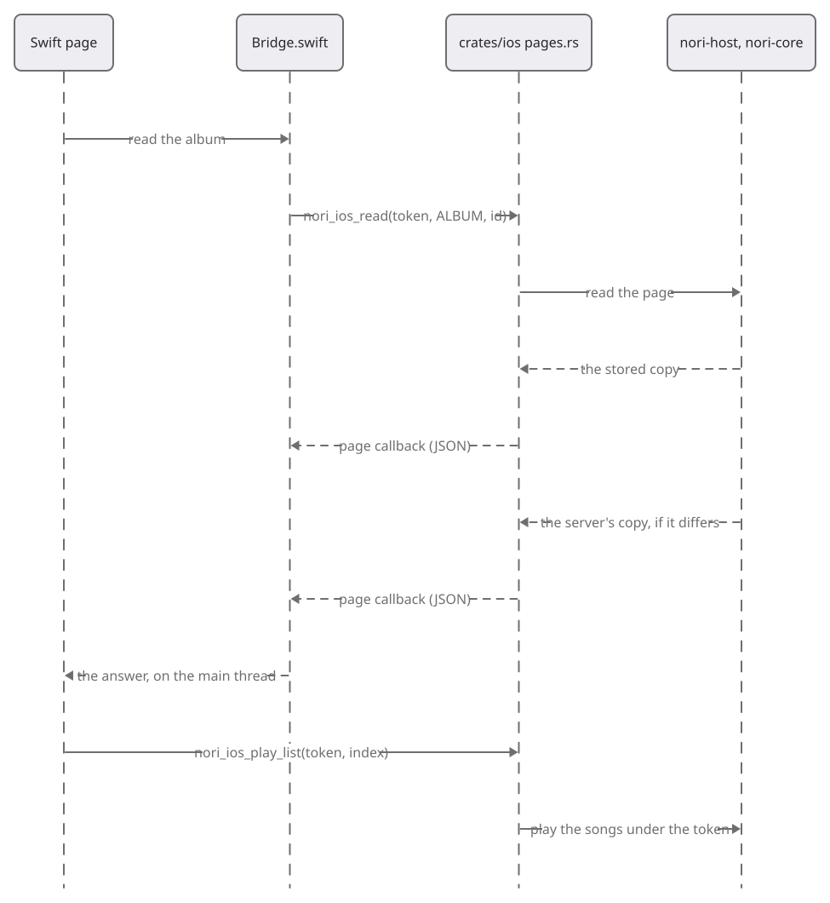

# The iPod client

The iPod client is a UIKit app (`ios/`) over a Rust static library (`crates/ios`, the `nori-ios` crate).
The library links `nori-host`, the same session the terminal and desktop clients use. Rust makes every
decision. Swift draws the screens, holds the words and calls the iOS APIs. When the two needs collide,
sound comes first, then how the interface feels, then the battery.

The client runs on the iPod touch 6th generation with iOS 12.2 or later, jailbroken. For what users see,
read the user guide, [iPod touch](https://norifm.com/docs/clients/ipod/).

<picture>
  <source media="(prefers-color-scheme: dark)" srcset="diagrams/ipod-layers-dark.svg">
  
</picture>

## The device

The client is built for one model, and its limits shape most choices on this page.

- The model is `iPod7,1` (`N102AP`). iOS 12.5.8 is its last system. It is jailbroken with checkra1n,
  which is semi-tethered.
- The SoC is an Apple A8 with two cores at 1.1 GHz. The system holds most of its 1 GB of memory.
- The screen is 4 inches, 320 × 568 points at @2x. There are no haptics, Touch ID, cellular radio or GPS.
- Sound goes to a 3.5 mm jack, one mono speaker, or Bluetooth 4.1 (A2DP).
- From iOS 12.2, the Swift runtime is part of the system, so the app ships none.
- The jailbreak supplies AppSync Unified (it installs fake-signed apps), `uicache`, `uiopen` and dropbear
  SSH. The device has no `awk` or `pgrep`.

iOS 12 has UIKit with large titles, `UIViewPropertyAnimator`, `UIFontMetrics`, drag and drop and
`AVRoutePickerView`. It has no SwiftUI, SF Symbols, diffable data sources, context menus, system dark
mode or sheet presentation controller.

## The parts

Swift imports the C ABI, `ios/Sources/nori_ios.h`, as its bridging header. `crates/ios` implements it over
`nori-host`, which runs the engine and the core. Beside the library, `ios/Sound/NoriAudio.m` runs the
audio session and the audio unit, and it hands iOS's notifications to Rust.

### The Rust library

These are the modules of `crates/ios/src/`:

- `lib.rs` holds `nori_ios_version` and `nori_ios_free`, which frees every string the library returns.
- `app.rs` holds the app's one `Settings`, under its queue session, for each database. The session,
  sync and the saved servers all read and write the settings through it. A second handle would write
  its older copy back over the first one's changes.
- `session.rs` holds the one open `nori_host::Session` and the controls. It sends reports, and it handles
  background, foreground and memory warnings.
- `output.rs` is the sound card: `IosOutput` over a `Sink`, and the render callback.
- `pages.rs` answers every page read with `nori_ios_read`, and serves covers, lyrics, settings, the
  first run's questions (`nori_core::setup`, never the mobile data one) and the covers they play, and the
  equalizer.
- `paging.rs` decides when a list's next page goes out (`nori_ios_read_more`), with the core's
  `paged::Paged`.
- `menu.rs` is the song menu (`menus::song_menu`), playlists and the sleep timer.
- `sound.rs` is each output's sound and the AutoEQ browser, through the core's `device_*` calls.
- `lyrics.rs` puts the core's `LyricClock` behind a handle that the lyrics page holds.
- `theme.rs` turns the `theme` and `season` settings into colors for the device's date and time zone. It
  also dyes a page with a cover's or a mix's color.
- `account.rs` is the login form (`providers`, `log_in`), the first run's welcome (`WelcomeFlow`), the
  saved servers and their icons (`ProfileIcon`), and their scrobbling accounts.
- `offer.rs` offers, on Home, the queue that another device left on the server (`offer::Offered`).
- `remote.rs` is remote control: Bonjour through the app, and the devices the music can move to.
- `jam.rs` is a jam that this iPod joined as a guest.
- `support.rs` is the Support page: the stamp book and the choice of what to give. The service is
  described in [Supporting nori](support.md).

### The Swift app

These are the files of `ios/Sources/`:

- `AppDelegate.swift` opens the session off the main thread. It passes on background, foreground,
  memory warnings and `nori://jam` links.
- `Bridge.swift` holds `Core`. It turns the library's reports into notifications on the main thread and
  sends page and cover requests.
- `Shell.swift` holds the tabs, the bottom chrome and the mini player. The pages each have their own
  file, such as `Home.swift`, `Pages.swift`, `Player.swift`, `Queue.swift` and `Settings.swift`.
- `Welcome.swift` holds the first run: the welcome while no profile is saved, then the questions over the
  app once the first one opens.
- `Devices.swift` holds the output picker, the devices sheet, joining a jam, Bonjour and the system
  volume.
- `Covers.swift` holds `CoverCache` and `CoverView`.
- `Design.swift`, `Theme.swift`, `Glyphs.swift` and `Iconoir.swift` hold the shapes, colors, fonts and
  drawn icons.
- `Say.swift` holds every word, and `Fmt` for times and sizes.

## How a page crosses the C ABI

Every door in `crates/ios` is `extern "C"`. `crates/uniffi-bindgen` generates Kotlin only, and the audio
unit's render callback cannot cross a generated binding. A C entry point carries no handle, so
`session.rs` keeps the open session in a process-wide slot.

The library answers a page asynchronously. This is what happens when you open an album and tap a song:

<picture>
  <source media="(prefers-color-scheme: dark)" srcset="diagrams/ipod-album-dark.svg">
  
</picture>

The page callback arrives on a library thread, and `Bridge.swift` moves it to the main thread. The
library keeps a page's songs under the token it was read with. Play, enqueue and download then name a
token and an index, so songs never cross the ABI twice.

## Rules that hold

- The coarse path answers one page per call, as JSON. Per-buffer work goes through `nori_ios_render`
  only.
- Swift frees every string the library returns with `nori_ios_free`. A cover's pixels stay valid until Swift
  passes their owner to `nori_ios_cover_release`.
- Reports go to the callback set with `nori_ios_on_report`, on a thread the library owns
  (`nori-ios-out`). Their kinds are the `REPORT_` constants in `session.rs`.
- A door that reaches the network blocks. The header marks those doors, and Swift calls them off the
  main thread.
- Nothing generates the header. You keep it in step with the Rust doors by hand. The same holds for
  `NoriGrant` in `ios/Sound/NoriAudio.h` and `AudioGrant` in `output.rs`.
- The render path pulls and stamps. It does not lock or allocate. A test counts its allocations.

## Where to change things

To add a door, write the `extern "C"` function in the module of `crates/ios` that owns the behavior.
Declare it in `ios/Sources/nori_ios.h` with the same signature. Then call it from Swift. Logic goes into
the core or `nori-host`, not into the door, so the other clients can use it.

To add a word, add it to `Say.swift`. To add an icon, regenerate `Iconoir.swift` with `tools/glyphs.py`.
Do not edit that file by hand.

## Sound

iOS has no deep buffer like Android's AudioTrack. Every audio path ends in an in-process I/O thread, which
the media server wakes once per I/O buffer. So the output is AURemoteIO itself, with the longest I/O
buffer that the session grants. `IosOutput` (`crates/ios/src/output.rs`) drives the unit through the shim
(`ios/Sound/NoriAudio.m`).

### How the output is set up

- The session category is `playback`. The preferred sample rate is the song's.
- The preferred I/O buffer is 93 ms (`DEEP_IO_MS`), about 11 wakes a second.
- While a sound page is in sight, `shallow` asks for 10 ms (`SHALLOW_IO_MS`). You then hear a moved band
  at once. `nori_ios_sound_page` tells the library which sound page is open.
- The unit's input runs at the rate Rust asks for. AURemoteIO converts it when the hardware rate differs.
- iOS moves the hardware to the preferred rate late. So the shim rebuilds the unit, at the same input rate,
  whenever the unit's output side changes.
- The output always takes Float32 (`takes_float`). With high quality output on, the music stays float from
  the decoder to the DAC, and nori adds no dither.

### Timing and fades

`latency_us` says when the music pulled now will be heard. It is the render timestamp's host time plus
the route's `outputLatency`. On Bluetooth, `mixed_us` is the route's latency.

The output does not fade by itself and does not pull in bursts. The ring's pulls run fades per sample.
The pull that crosses the ring's low mark wakes the engine.

### Routes, interruptions and failures

The shim decides nothing. It hands each event to Rust as it arrives:

- A route change maps the port to Speaker, Wired, Bluetooth (with its name) or Other. Each output's sound
  and the AutoEQ offer use it.
- A lost route (headphones pulled, a Bluetooth device gone) pauses.
- An interruption is the engine's audio focus (`Engine::focus`), in `session::audio_changed`. It pauses
  what played. When iOS says to resume, it plays only what the interruption paused.
- After a media-services reset, the output rebuilds the unit once. If that fails, `failed` tells the
  engine.

Pausing stops the unit. After the engine's idle release (5 minutes paused), the output closes and the
session goes inactive, so iOS can suspend the app.

### Volume and the lock screen

iOS keeps the volume, and nori does not scale samples for it. Swift observes the system volume
(`outputVolume`) and passes it to `nori_ios_volume`, so other devices see it. A volume set from another
device moves the system volume through a hidden `MPVolumeView` (`SystemVolume` in `Devices.swift`).

`NowPlaying` in `Player.swift` registers `MPRemoteCommandCenter`, whose commands come from the EarPods
remote, the lock screen, Control Center and Bluetooth. Each one goes to `nori_ios_media_key`, which calls
the session's `media_key`. `MPNowPlayingInfoCenter` updates on each change, never on a timer.

## The interface

The interface follows Nori Seasons with Android as the reference, in layouts of the iPod's own. The user
guide shows the screens. These are the rules a contributor needs:

- The shell (`ShellController`) has Home, Library, Settings and Search, each a navigation stack. The
  Settings tab shows only when the profile opens some settings.
- The bottom chrome is one outlined pill that holds the mini player over the tabs. It is a flat plate
  with no blur.
- The mini player has no progress line, because it would tick.
- The player card's times update twice a second. They do so only while the card shows, the app is
  active and music plays.
- The core's `LyricClock` paces the lyrics page. A display link runs only while a word fill moves,
  and a one-shot timer waits between lines. Nothing runs while paused, buffering or hidden.
- Swift picks the settings rows (`SettingsGroup`) over the core's settings model (`nori_ios_settings`,
  `nori_ios_set`). It leaves out settings that only a phone has: metered network, offload, bit-perfect
  and USB.
- `Theme.swift` reads the palette from `nori_ios_look`. It rebuilds the views when the theme or season
  changes, and when the app becomes active on another day.
- Inter is the font for everything, and Literata for page titles. `UIFontMetrics` scales both for Dynamic
  Type.
- Animations run as Core Animation layer properties on the render server. The system's Reduce Motion
  turns fades and slides into direct changes.
- VoiceOver labels cover the glyph buttons, the rows and the drawn lyric lines.
- While no profile is saved, the welcome covers the app. Its sources are the core's kinds of profile
  (no plugins or backup restore here), and Continue opens the form, as the core's `WelcomeFlow` says
  (`nori_ios_welcome_*`, a handle Swift holds). Once that profile opens, the questions take its place
  (`nori_ios_setup`): between songs, previewed on the core's fixed covers (`nori_ios_setup_cover`, WebP
  decoded in Rust) that slide together and cross-fade through a gradient mask, then Settings' own
  appearance and season controls. Each pick is applied as Settings applies it. A theme change rebuilds
  the interface with the first run over it where it was.

### Covers

Swift asks for a cover at the view's pixel size. The library hands it over as RGBA, which becomes a
`CGImage` without a copy. `CoverCache` holds up to 16 MB of decoded covers. While a size loads, it
shows the sharpest picture already decoded. When a song starts, the library warms the covers of its
neighbors in the queue into the disk cache.

## Remote control and jams

Remote control runs only while the `remoteControl` setting is on. The session's remote reaches the
devices paired with the iPod through their group's room on the sync server (see `sync.md`). It also
serves the LAN door, as on the desktop. Swift does the Bonjour part: `Devices.swift` announces the door, and it
looks for the group's other devices while the core asks (`nori_ios_on_bonjour`). When the app is paused
in the background, iOS suspends it, and its door stops with it.

Pairing and profile sync have their own pages in `Sync.swift`: Your devices and Pair a device. They read
`nori_ios_sync_state` again on each `NORI_REPORT_SYNC`.

The iPod joins a jam only as a guest, from a pasted invite link or a `nori://jam` link. A guest profile
opens in place of your own (`nori_host::jam_joined`), and it follows `ProfileRules` (`nori_ios_rules`).

## Memory, storage and network

- `MEMORY_MB` in `session.rs` is 96, so `load_control` lets the engine hold 24 MB of audio ahead.
- A memory warning empties `CoverCache` and the core's decoded covers (`nori_ios_memory_warning`). Swift
  keeps no pages: it reads, draws and drops them.
- The data lives in `Library/Application Support/nori/`, excluded from backups. It holds `nori.db`, the
  stream cache and downloads, `covers/` and `nori.log`.
- The app runs from `/Applications` as `mobile`, so the full data path is
  `/var/mobile/Library/Application Support/nori`.
- The `cache_mb` setting caps the stream cache. Downloads have no cap. Both use the core's eviction order.
- The iPod has no cellular radio, so the network is always unmetered.
- When the app enters the background, `nori_ios_background` saves the queue (`QueueMoment::Closing`).
  Downloads and AutoMix measuring run only while the app is open or playing. The Downloads page says so.

## What the iPod client does not have

- **Plugins.** The library builds `nori-core` and `nori-host` without default features, so it has no
  plugin host. It plays from Subsonic servers only, so there is no YouTube Music. A plugin's profile that
  sync brings waits, and Your devices lists no plugins for the profiles to install.
- **Server options.** `nori-http` applies no custom headers, self-signed certificates or client
  certificates.
- **Better beat detection.** The `neural-beats` feature is not built for this device.
- **Hosting a jam.** The iPod can only join one.
- **Background downloads.** Nothing downloads while the app is suspended. There is no `NSURLSession`
  background session.
- **Offload.** The library has no `OffloadOutput`, so nori decodes every song itself.
- **nori's Motion setting.** The iPod follows the system's Reduce Motion, not the `motion` setting.
- **The core's settings pages.** Swift picks its own rows (`SettingsGroup`, `Say.settings`) instead of
  reading `settings_pages`. `SettingsClient` has no iPod variant.
- **The perf recorder.** iOS gives no per-thread count of context switches. The bench reads the app's CPU
  and memory from outside.
- **Other languages.** The words are English only, in `Say.swift`. `Fmt` has no test vectors against
  Android's `Fmt.kt`.

## Build and install the app

Everything builds in Docker (`tools/ios-build/Dockerfile`), on Linux or a Mac, with no Xcode. The image
has swift.org's Swift and clang, lld's Mach-O linker, Rust with the `aarch64-apple-ios` target, sccache
and Procursus' `ldid`.

You need:

- Docker. On a Mac, use Docker Desktop, or `brew install colima docker`.
- For installing and running: `sshpass`, `nc`, and libimobiledevice (`iproxy`, `idevice_id`).
- The iPod on USB, with checkra1n's dropbear running.

Run the script with the steps you want:

```sh
tools/ipod.sh                 # build; with an iPod on USB, also install and run
tools/ipod.sh build           # build/ios/nori.app and build/ios/nori-ipod-<version>.ipa
tools/ipod.sh install run     # only those steps
```

`install` copies the app to `/Applications/nori.app` over SSH and runs `uicache --path … --respring`.
`run` opens it with `uiopen -b dev.nori.music`, then prints the process and the data directory.

The script reaches the iPod over USB. `iproxy` forwards port 2244 (`NORI_IPOD_PORT`) to dropbear's port
44. It uses password authentication (`NORI_IPOD_PASSWORD`, default `alpine`), because this dropbear
stalls after it accepts a key.

When `NORI_SUPPORT_URL` and `NORI_STRIPE_KEY` are set, they go into the build, and it has a Support page.
A release carries the `.ipa`: the release workflow's `ipod` job runs `tools/ipod.sh build`.
`tools/release.sh` also builds it beside the APK, unless you pass `--no-ipod`.

### What the build does

`tools/ios-build/build.sh` runs inside the container. There is no Xcode project. It downloads theos'
iPhoneOS 16.5 SDK and parts of swift.org's macOS toolchain once, and checks the SDK's SHA-256. It builds
`libnori_ios.a` with Cargo (`--profile dist --target aarch64-apple-ios`, deployment target 12.2). It
compiles `NoriAudio.m` with one `clang` call. One `swiftc` call (`-O -wmo`) compiles the app and links
it through lld. It signs the executable with `ldid -S` and `ios/entitlements.plist`, then zips
`Payload/nori.app` as the `.ipa`.

The downloads, Cargo's home and Cargo's target directory stay in the Docker volume `nori-ios-cache`. They
cannot live in a folder that Docker shares from a Mac. The SDK is an archive of symlinks that cannot be
unpacked there, and rustc dies with SIGBUS on mapped files there.

The launch screen is a plain image (`UILaunchImages`), so the build needs no Interface Builder tools.
Linux's Swift resource directory has its own `Dispatch` module, which clashes with the SDK's. So the build
assembles a resource directory from Linux's `shims` and `clang` and the iOS parts.

### Toolchain problems the build works around

- **The linker.** Binaries from Xcode 26's linker crash on iOS 12.5. lld writes the classic load commands:
  dyld info, no chained fixups.
- **The Swift optimizer.** swift.org's compiler moves the release of the empty array's storage above its
  retains. Only immortal storage survives that, and iOS 12's runtime has none, so the app aborts in malloc
  after launch. The build turns off the `retain-sinking` and `release-hoisting` passes
  (`-sil-disable-pass`). To check another toolchain, run `otool -tV -p '_$s4nori4CoreCACycfc'`. No
  `swift_release` may follow the `dictionaryLiteral` calls.
- **System-app entitlements.** launchd never starts an app in `/Applications` without
  `platform-application` and `com.apple.private.security.no-container`. It writes no crash report, and
  `uiopen` returns 0 all the same. `ios/entitlements.plist` carries both, as Zebra and Filza do, plus
  `skip-library-validation` and `get-task-allow`.
- **macOS tar.** It adds AppleDouble `._` files unless `COPYFILE_DISABLE=1` is set. `install` sets it.

### Debugging on the device

No Xcode debugger attaches to iOS 12. Read the core's log, `nori.log` in the data directory, over SSH.
Crash reports are in `/var/mobile/Library/Logs/CrashReporter/`. Symbolicate them with `atos` against the
unstripped executable.

## Testing and measuring

`cargo test -p nori-ios` tests the output on a simulated sink and the session on `WavOutput`. It also
tests the doors the screens read. `tools/check.sh ipod` runs Clippy on the crate alone, without the desktop parts that a
workspace build gives `nori-host`. [Testing](testing.md) lists what only the device can show.

`tools/ipod-bench.sh nori|music` measures battery and CPU while a playlist plays with the screen off.
Run it once for nori and once for Apple's Music app, on the same downloaded songs.

1. Set `NORI_IPOD_HOST` to the iPod's Wi-Fi address. The bench uses Wi-Fi, because USB charges the
   battery.
2. Unplug the iPod.
3. Start the playlist in the app you measure, then lock the screen.
4. Run `tools/ipod-bench.sh nori` or `tools/ipod-bench.sh music`.

   The script samples the battery and the app's memory every 30 seconds for 30 minutes. It writes a CSV
   to `build/` and prints the mean current, the app's CPU share and its memory.

   If the app restarts during the run, the script stops. Start it again.

Change the length with `--minutes N` and the interval with `--every S`. `--plugged` samples on external
power, which checks the script but measures nothing.
