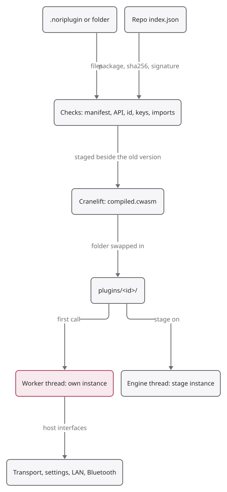

# The plugin host

The plugin host, `crates/plugins` (`nori-plugins`), installs plugins, checks them, compiles them with
wasmtime and Cranelift, and runs each one in a sandbox. It is one crate under every client but the web
client and the iPod app. A client gives it the open profile's transport, the settings and a `Client` for
what only the platform can do, and draws what it answers. With no plugin on, it reads a few small files
and does nothing else: no engine, no compiling, no thread.

For what a plugin can do, see [Plugins](plugins.md). For the manifest, the limits and the API, see the
[plugin reference](plugin-reference.md).

<picture>
  <source media="(prefers-color-scheme: dark)" srcset="diagrams/plugin-install-dark.svg">
  
</picture>

## The parts

| Part | Where | What it owns |
|---|---|---|
| The API | `wit/` | The `nori:plugin` package: host interfaces, extension points, the `plugin` world |
| The SDK | `crates/plugin-sdk` | The WIT as Rust, the manifest's encoding, `plugin!`, the signing example |
| The index rules | `crates/plugin-index` | `index.json`, the manifest section, package checks, `web_blocks`, README blocks |
| The host | `crates/plugins` | Installing, compiling, workers, host interfaces, safe mode, repos |
| Sound stages in the chain | `crates/player/src/stage.rs` | The master and song slots, inputs, the tap for preparation |
| Overrides | `crates/settings/src/overrides.rs` | The layer laid over the settings, the tunables |
| Providers | `crates/core/src/providers/plugin.rs` | A plugin's `provider` export as a `Provider`, through `Kinds` |
| Desktop and terminal glue | `crates/host/src/plugged.rs` | The `Client` for the desktop and terminal apps, BlueZ and macOS Bluetooth |
| Android glue | `android/core/src/main/kotlin/dev/nori/music/plugins/` | `PluginHost.kt`, Bluetooth, receivers, the LAN |
| Casts in the engine | `crates/engine/src/cast.rs`, `cast/deep.rs` | The cast output card, the deep sink pump |
| The web host | `web/src/plugins/` | Plugins in a browser, as JavaScript |

In `crates/plugins`, each file holds one part. These are the ones most changes touch:

- `package.rs` installs a package, and `repo.rs` reads repos and finds updates.
- `runtime.rs` holds the engine and the linker, and `worker.rs` the plugin's own thread.
- `host.rs` implements the basic host interfaces: log, store, HTTP, settings, rows and notices.
- `stage.rs` runs a sound stage on the audio path.
- `safe.rs` is safe mode, and `view.rs` is what clients draw.
- `lan.rs`, `sockets.rs`, `door.rs`, `cast.rs`, `sink.rs` and `deep.rs` are the LAN and casts.
- `bluetooth.rs` and `devices.rs` are Bluetooth and device control.

## What is on disk

The plugins live in one folder, `plugins/` under the client's data folder:

- `index.json` holds the installed plugins in the user's order, and the repos the user added. For each
  plugin, it keeps whether it is on, its repo, whether it is kept at its version, and its pinned key.
- `safe` is safe mode's marks.
- `<id>/` holds one plugin: `plugin.wasm`, `strings/`, `icon.png`, `README.md`, `manifest.bin` (its
  manifest section), `compiled.cwasm` and `compiled.key`, and its `store/`, `cache/` and `assets/`.

Opening the host reads `index.json`, each plugin's `manifest.bin` and `safe`. It never reads a wasm at
start.

## How a plugin is installed

`Plugins::install_as` installs a package from a file, a folder or a repo. `package::install` does the
work, in this order:

1. It reads the package's files and the manifest from the wasm's `nori:plugin` section.
2. It checks the manifest's API version, id, override keys (`nori_settings::overrides::overridable`),
   assets and stage slot. `Plugins::admits` checks the pinned key.
3. It writes the files to `.<id>.new/` beside the installed version, with `manifest.bin`.
4. It compiles the component there (`runtime::component`). A component that imports a call of an
   interface not in `runtime::LINKED` is refused as `Refusal::Needs`.
5. It moves the old version's `store/`, `cache/` and `assets/` into the new folder, and swaps the
   folders.

A package from a repo is fetched first, and `nori_plugin_index::package::checked` compares its sha256
and verifies its signature before step 1. The install sheet runs steps 1 and 2 only.

What an install keeps of the version it replaces is one rule for both hosts,
`nori_plugin_index::standing::installed_over`. An update keeps its switch, its place and whether it is
kept at its version. A new plugin goes last and turns on. A plugin that can't start stays installed,
and its failure goes to the log.

### Compiling

`runtime::engine` makes one wasmtime engine per process, at the first plugin it compiles or loads, with
fuel counting and Cranelift's speed level. A plugin is compiled once and kept as `compiled.cwasm`.
`compiled.key` holds the engine's compatibility hash. A load whose key differs (a newer nori) compiles
again from `plugin.wasm`. nori never downloads native code. In the `dist` profile, Cranelift is built
for size, since it runs only at install, and wasmtime's calls into plugins for speed.

## How a call runs

Each running plugin has its own instance on a thread of its own, the `Worker` (`worker.rs`), named
`plugin <id>`. The thread starts when the plugin is turned on, if it has a lifecycle, or at its first
call. Its calls may block: its HTTP waits on the core's transport there, so the core's executors never
wait on a plugin.

- **Fresh instances.** A call that traps or spends its fuel fails, and the instance is dropped. The
  next job makes a fresh one, which runs `lifecycle.start` again and hears the provider's opening again
  (`Worker::opens`).
- **Fuel.** Each job gets `runtime::CALL_FUEL`. A decider's call gets `worker::DECIDE_FUEL`, and
  `Worker::decide` waits at most its budget. An answer that comes later is dropped.
- **Callers that left.** A `call` whose caller has gone, such as a search typed over, is skipped when
  its turn comes. A call that already began stops waiting for its HTTP (`host::Caller`). Its requests
  on their way are dropped and answer with an error, and new ones are refused. The plugin returns
  early, and its thread goes on to the next call.
- **Memory.** Each store is capped at 256 MB and 16 instances.
- **WASI.** `runtime::wasi` answers randomness, the clocks and an empty environment, at whatever WASI
  versions the component imports. It links every other import to a trap.

Dropping an instance's `Host` lets go of what it holds on the LAN (`Lan::forget`): its browsing,
endpoints, audio and cast. This happens when the plugin is turned off, removed or updated, or a call
fails.

### The store, cache and assets

A plugin's store is a file per key in `store/`, 1 MB in all (`store::STORE_CAP`). Keys under `nori/`
are the host's: its rows' values (`nori/row/`) and its overrides (`nori/override/`). A plugin cannot
write them.

The cache is a file per key in `cache/`, up to the manifest's quota. A put over the quota drops the
keys used longest ago. Assets are fetched through the open profile's transport in 4 MB range requests,
hashed as they come, and kept by sha256 in `assets/`. On a metered network an asset waits until the
user allows mobile data for that plugin (`Plugins::allow_mobile_assets`).

An update keeps the store, the cache and the assets. Removing the plugin removes them.

## HTTP, sockets and the proxy

`http.fetch` checks the URL's host against the manifest's `net`, and private addresses against `lan`.
It sends the request through the open profile's `Transport`, nori's one connection pool. `http.start`
puts up to 16 requests on their way at once, each on a thread of its own. `wait` and `take` collect
their answers.

Plugin HTTP takes the client's proxy, as nori's own requests do. On Android that is the system's proxy.
On the desktop and terminal apps, `nori-http` takes it from `ALL_PROXY`, `HTTPS_PROXY` or `HTTP_PROXY`,
except for `NO_PROXY`. It has no SOCKS support.

Sockets never go through a proxy: a socket is mostly for the LAN, and an HTTP proxy carries no UDP. TLS
on a socket is rustls with ring. It checks against webpki's roots or one pinned certificate, and only a
private address may skip the check.

## Sound stages on the audio path

`Plugins::stages` makes a `stage::Maker` for each enabled plugin with a stage, compiled at first need.
The engine makes a `Stage` per chain. A stage has an instance of its own on the engine's thread, with
every import linked to a trap, so it never waits on anything.

- A block goes in as one `list<f32>` and comes back the same length. The SDK exports `process` and
  `save` by hand without a post-return (`stage_abi`). The host reads the answer in the plugin's memory
  and allocates nothing per block.
- Each block gets `BLOCK_FUEL`. A trap or a block over its fuel bypasses the stage until the next reset
  (a seek or another song), which makes a fresh instance.
- The inputs (`nori_player::stage::Inputs`) are copied into the plugin's memory when they change, never
  per block. A change of a row, the volume or the route is a sound change, spliced in.
- At every mark the chain saves the stage, and a splice restores it, so music made again is the same,
  bit for bit.

### Song preparation and AutoMix analysis

The plugins with `preparation` or `automix` hear each song as the player reads it. The reader's tap
(`nori_player::stage::Tap`) copies decoded samples into a feed and never waits. What the feed can't take
is dropped. One thread, `nori-prepare` (`prepare.rs`), holds an instance of each such plugin. It wakes
when a feed is half full or the song ends, and sleeps while nothing is read. If no plugin wants a song,
the tap copies nothing more. Prepared data is kept in memory for the last four songs and reaches the
plugin's stage as the song's facts.

## Hooks, timers and wakes

Nothing is built for an event that no enabled plugin hears. `Plugins::hears(hook)` is one load of a
bit set, remade when plugins change, and a client checks it, or `Plugins::follows()`, before it builds
an event. The playback, song, queue and route events are told apart in Rust from the client's
`Moment`s (`hooks.rs`), once for every client.

- **Lyric lines** wake the host at each synced line of the song playing, the screen off too. That wake
  is the cost the install sheet names. A pause, a seek or a new song lets the waiting wake go.
- **The output picker.** Each client says whether its picker is open (`Plugins::output_picker`), and the
  host tells plugins only a change. A plugin that finds devices browses only while the user picks.
- **Timers** run on the host's executor (`timers.rs`). A timer that may not fire waits on the `Gate`,
  not on a clock, so it costs no wake. The client watches the screen (`Client::watch_screen`) only while
  an `always` timer runs.
- **Wakes and commands.** The client keeps on only the receivers some enabled plugin wants
  (`Client::wake`, `Client::commands`). On Android, `PluginBootReceiver`, `PluginBluetoothReceiver` and
  `PluginCommandReceiver` are declared disabled and turned on only then. Another app runs a command with
  the `dev.nori.music.RUN_COMMAND` broadcast, holding `<applicationId>.permission.RUN_COMMAND`. On Linux,
  the desktop and terminal apps own `fm.nori.Commands` on the session bus only while a plugin has
  commands.

## Overrides

The host keeps a plugin's overrides in its store and lays the enabled plugins' overrides over the
settings in their order (`nori_settings::overrides::Layer`). Everything nori does reads the settings in
effect (`Settings::effective`). Only the settings screens, and edits that write the settings back, read
the stored ones.

The layer changes when a plugin overrides or clears a key, a row changes, or a plugin is turned on or
off, moved or removed. When that changes the settings in effect, the client hears `layer_changed` and
derives the engine's settings again (`nori_engine::core::settings(stored, layer)`), as for a settings
change. Nothing reads the layer per buffer.

## The LAN and casts

A plugin with `lan` among its hosts may reach private addresses: RFC 1918 and RFC 4193 ones,
link-local, loopback, and the LAN's multicast groups. A host name counts only when every address it
resolves to is private.

- `discovery.browse` asks the client to browse mDNS while any plugin browses that kind: Android's NSD,
  `mdns-sd` on the desktop and terminal apps.
- `lan-serve` is the plugins' door (`door.rs`). It serves plain HTTP on a port the system picks, while
  a plugin asks for it or serves audio. `/p/<id>/...` goes to plugin `id`'s `served` hook. It is its own
  listener, apart from remote control's, which takes only signed requests.
- `audio-out` makes a `Sink` that the client's engine plays into (`Plugins::set_cards`): into the
  plugin's socket, or served at the door's `/a/<encoding>`. The engine pumps it in real time, half a
  second ahead, on a thread of its own. With `pace.deep`, it is a deep sink instead.
- `cast.offer` lists devices as rows of nori's own output pickers, on every client, and in the device's
  remote state for the account's other devices. Picking one runs `action("cast:<id>")`. One plugin
  casts at a time.

A target cast parks the music on this device (`Card::Elsewhere`): nori's queue moves, plays and pauses
for the device, and nothing plays here. When the cast ends, the music plays on here from where the
device was. While a sink plays, nothing goes to the phone's offload. Android holds a Wi-Fi lock while a
sink streams (a deep sink's only during a burst), and its media session shows the cast's device.

### Deep sinks

A deep sink is a device that holds tens of seconds of audio, such as a speaker with PSRAM. It takes
nori's audio as a phone's AudioTrack does: a burst, then nothing until it runs low. The phone's radio
and CPU sleep between bursts. The host speaks the protocol, `nori-sink-protocol`
(`crates/sink-protocol`, `no_std` with `alloc`, so firmware uses the same code). The plugin only finds
the device, connects, calls `audio-out.to-socket` with `pace.deep`, and starts the cast. No plugin code
runs per buffer. The protocol's version is 3.

Every frame is a `u32` length of the bytes after it, a kind byte, then its fields, all little-endian.
Strings are a `u16` length and UTF-8. An option is a byte (0 none, 1 some) and the value. Byte payloads
run to the frame's end. A frame is at most 1 MiB.

The host sends `Hello` and waits 3 s for `Caps`. Nothing else comes first. Then it sends `Depth`, and a
`Format` before the first audio. These are the host's frames:

| Frame | Kind | Fields | Meaning |
|---|---|---|---|
| `Hello` | 0x01 | `version: u16` | The first frame, which `Caps` answers |
| `Depth` | 0x02 | `ms: u32` | How much to hold, asking for more when under half of it |
| `Format` | 0x03 | `rate: u32, channels: u8, bits: u8, codec: u8` | The format of the audio after it |
| `Audio` | 0x04 | Samples | PCM in whole frames, interleaved |
| `Encoded` | 0x05 | Bytes | One whole FLAC or MP3 frame of the file |
| `Gain` | 0x06 | `db: f32` | The gain of the encoded song that follows |
| `Flush` | 0x07 | `seq: u32, keep: option<u64>` | Drop what is held past stream frame `keep`, or all of it |
| `Pause` | 0x08 | None | Stop at once, keeping what is held |
| `Resume` | 0x09 | None | Go on playing |
| `Ramp` | 0x0a | `target: f32, ms: u32` | Fade linearly to `target`, 0 to 1, over `ms` |
| `Volume` | 0x0b | `gain: f32` | The user's volume, 0 to 1, heard at once |
| `Cover` | 0x0c | `id: u32`, JPEG | A cover at the size `Caps` asked |
| `Now` | 0x0d | `id, title, artist, album, duration_ms, cover, at_ms` | The song that follows, and where in it the audio starts |

In `Format`, codec 0 is PCM, 1 is FLAC and 2 is MP3. `bits` is PCM's width (16 or 24), or 0 for an
encoded codec. 24-bit PCM is packed in 3 bytes. A FLAC song's first `Encoded` frame is `fLaC` and its
STREAMINFO block. `Gain` comes only before encoded songs: in PCM, nori applied the gain to the samples.
The device answers `Flush` with `Flushed` and `Status`, and `Pause` and `Resume` with `Status`. A
`Cover` comes once, before the first `Now` that names it. The host fits `Depth` to 90 % of
`buffer_bytes` at the format, and asks for 250 ms while a sound page is being tuned.

These are the device's frames:

| Frame | Kind | Fields | Meaning |
|---|---|---|---|
| `Caps` | 0x81 | `version: u16, buffer_bytes: u32, max_rate: u32, bits: u8, decodes: u8, cover: option<u32>` | What the device can do |
| `Want` | 0x82 | `frames: u32` | Send this many frames more, in place of any credit left |
| `Status` | 0x83 | `played: u64, held: u32, delay_us: u32` | Frames played since `Hello`, frames held, the delay after the buffer |
| `Flushed` | 0x84 | `seq: u32, played: u64` | Flush `seq` is done |
| `Press` | 0x85 | `button: u8` | A button: 0 play-pause, 1 next, 2 previous |
| `Volume` | 0x86 | `gain: f32` | Its own knob, which sets the cast's volume |
| `Seek` | 0x87 | `ms: u32` | Go to `ms` in the song playing |

In `Caps`, bit 0 of `bits` is 16-bit and bit 1 is 24-bit, and bit 1 of `decodes` is FLAC and bit 2 is
MP3. `cover` is the square size of the device's screen in pixels, or none. Only a song above `max_rate`
is resampled. nori takes a `Press` as a media button, so plugins' deciders apply. nori sends a `Volume`
from the knob nowhere back. A device sends `Seek` only to a host whose `Hello` said version 3 or more.

These rules hold for the stream:

- **Positional frames.** `Format`, `Gain` and `Now` apply where they sit in the stream, and wait in the
  buffer with the audio. A flush drops them with the audio past `keep`. After a flush, the first audio
  comes after a `Format`, and a `Gain` and `Now` where they apply, so the device never guesses.
- **Credit, not TCP.** The device reads its socket always. Under half its depth, it sends one `Want` and
  a `Status`. The host writes exactly that much audio, then nothing until the next `Want`. Encoded audio
  goes in whole packets, so the last one can overshoot the credit by less than a packet.
- **Control frames first.** Control frames never wait behind audio. The host keeps its send buffer at
  64 KB, so a seek or a pause is heard in milliseconds.
- **No timer.** The pump sleeps between `Want`s and wakes only for the device, the engine or the socket.
  The device sends `Status` with each `Want` and in answer to `Pause`, `Resume`, `Depth` and `Flush`,
  never on a period. The host runs the position on by its own clock.
- **Flushes.** A seek or a jump drops everything. A sound change keeps what the device holds up to the
  frame where the music was made again. The change is heard within a fraction of a second.
- **Each song's own format.** With no rate asked, each song goes at its own rate and channels. The engine
  reopens its output between songs of different formats, never inside a mix, and a deep sink takes the
  `Format` in its stream.
- **Offload.** While nothing touches the samples (`nori_player::policy`) and the device decodes the
  codec, the engine sends the file's own packets: `Format` with the codec, then `Encoded`. It seeks by
  the file's seek table or bitrate. ReplayGain is a `Gain` at each song's start, and fades are `Ramp`s.
  An MP3 that joins its album gaplessly plays as PCM, because MP3 encoder gaps are not sent.
- **Now playing.** At each song's first frame, the host sends `Now`, with how far into the song it
  starts. If `Caps.cover` asked a size, the song's cover comes once before it. Covers come from nori's
  cover cache, JPEG only. A cover not on disk yet is fetched in the background and goes with the
  album's next song.

A device's firmware must do these things:

- Read its socket always, and answer `Hello` with `Caps`.
- Keep a FIFO of audio and positional frames, with stream frame counts.
- Switch format, gain and now playing exactly where they sit in the stream.
- Send one `Want` at a time when it holds less than half its depth.
- Flush by truncating at `keep`, or everything, and drop audio that comes in up to where it played.
- Pause and resume at once.
- Apply `Ramp`, `Volume` and the song's gain as gain stages: fade × volume × song gain.
- Send `Press` and `Volume` from its buttons and knob.

## Device control

A plugin reaches only the Bluetooth devices its manifest's filters match. Each client gives the host
its platform's Bluetooth as a `Bluetooth` (`bluetooth.rs`), with `Plugins::use_bluetooth`:

- Android uses `BluetoothSocket` and `BluetoothGatt` (`PluginBluetooth.kt`).
- Linux uses BlueZ over the system bus (`crates/host/src/bluez.rs`).
- macOS uses IOBluetooth and CoreBluetooth (`crates/host/src/macbt/`). IOBluetooth reports on the main
  thread's run loop, so the terminal app runs itself on another thread
  (`nori_host::beside_main_run_loop`).

These rules hold on every platform:

- The platform watches devices connecting only while an enabled plugin reaches devices. With none, no
  receiver, bus connection or thread exists. On Android, `BLUETOOTH_CONNECT` is asked for when such a
  plugin is installed.
- A device that connects is offered to the enabled `device-control` plugins that reach it, in their
  order (`handles`). The first that says yes controls it while it stays connected. nori asks for its
  `state` then, after each notification and after `set-noise`, never on a timer.
- A device nobody took, or whose channel was lost, is offered again a few times over half a minute. It
  is offered again when the app comes to the front, too. A lost channel is taken back at most three times in a row.
- Clients draw what `Plugins::controlled` gives: batteries, noise control and the controlling plugin's
  card.

## Safe mode and the switch over every plugin

`safe.rs` keeps `plugins/safe`, a small file the host maps into memory, locked while one run has it.
Each call into a plugin is marked in its slot with an atomic store as it starts and one as it ends.
Loading compiled code counts as a call. The kernel keeps the file however nori stops. A wait inside a
call (an HTTP answer, a socket's or a channel's read) is unmarked. So the system ending nori while a
plugin waits blames no plugin.

- At the next start, a plugin nori stopped in is turned off and logged, and its card says so
  (`Stopped::Crashed`). `take_safe_start()` answers `SafeStart::Crashed` once, for the client to say.
- A start that never reached `started()`, with no plugin marked, starts the next run with every plugin
  paused (`SafeStart::AllOff`). Their own switches stay. The run after that runs them again.
- A platform can say how the last run ended (`Client::last_exit`, Android's `ApplicationExitInfo` on
  API 30 and later). After a run the user or the system ended (`LastExit::Killed`), only a panic in a
  call turns its plugin off.
- A second nori over the same folder reads and marks nothing.

The `pluginsOff` setting turns every plugin off and keeps their own switches. It tells a nori bug from
a plugin's. `Plugins::running()` is then empty, and the settings leave the layer out.
`Plugins::report()` lists the plugins on and what each overrides, in English, for Android's bug report
and the perf build's self test.

## Backups

A backup (`crates/backup`) keeps the plugins as `Plugins::kept` gives them, in their order: each one's
id, version, repo, switches and store. `Plugins::restore` fetches each plugin from its repo at the
version backed up, else the newest that repo lists, then writes its store back. A plugin installed from
a file does not come back. A backup leaves out `cache/` and `assets/`, which the plugin fetches again.

## The web host

A browser has no wasmtime, so the web client (`web/src/plugins/`) runs a plugin as JavaScript.
Installing transpiles the component with `@bytecodealliance/jco-transpile` (`install.ts`), a 4 MB
module fetched only then, and keeps the code in IndexedDB with the plugin's store. While no plugin is
installed, none of this loads: `nori-plugins` in `localStorage` says one is.

- What runs there is one rule, `nori_plugin_index::web_blocks`, for a repo's listing and for a package
  being installed. Lifecycle, hooks, sound stages, slots and overrides run. Other points and imports are
  greyed out with the reason.
- A plugin runs in its own worker (`runner.ts`), since its host calls block and only a worker has
  synchronous XHR. WASI is a stub of clocks and stderr (`wasi.ts`). `settings.stored` and `effective`
  answer none, since a worker's call can't wait for the core.
- A sound stage runs in the AudioWorklet (`stage.ts`, `web/src/worklet.ts`). It sees the sound after the
  volume, with no `latency` compensation, and its route is always `speaker`.
- Browsers will not send most of a plugin's requests. Most sites send no CORS headers, and `Origin` and
  `User-Agent` can't be set. `/plugin-http` on the page's own server carries them (`web/serve.py`, HTTPS
  to public addresses only, `X-Plugin-Http: 1` in answer to `?ping`). Without that route, a plugin that
  names hosts is greyed out as `OtherSites`, and packages install only from a file.
- A package installs on the same terms as natively: `nori_plugin_index::package` checks its sha256 and
  signature in the worker.

## Rules that hold

- With no plugin on, the host makes no engine, compiles nothing and starts no thread. The engine's perf
  bench measures the same wakes, CPU and allocations as without plugins.
- No core executor waits on a plugin. A plugin's calls run on its own thread.
- Audio never waits for a plugin. A stage's imports trap, and a failed stage is bypassed.
- The host allocates nothing per block of a sound stage, and copies a stage's inputs only when they
  change.
- No event is built that no enabled plugin hears, and no timer that may not fire holds a wake.
- A plugin's overrides never write the user's settings.
- A rule both hosts follow lives once, in `crates/plugin-index`: package checks, what an install keeps,
  what runs in a browser.

## Where to change things

- **A new host interface or call.** Add it to `wit/host.wit` or `wit/net.wit` and to the `plugin`
  world, link it in `runtime::linker` and `runtime::LINKED`, and implement it on `Host`. Add it to
  `WEB_IMPORTS` in `crates/plugin-index` if the web host answers it. Update the fingerprint in
  `tests/api.rs`. The API version stays.
- **A changed record, function or export, or a new extension point.** This is a new API. Raise `API` in
  `crates/plugin-index/src/section.rs` and in the SDK's `manifest.rs`. Raise the package version in
  `wit/` and in the export names in the SDK's `build.rs` and the host's `stage.rs`. A new point also goes
  at the end of `POINTS`, whose order is the manifest's bits, and of `POINTS` in nori-plugins'
  `tools/pack.py`. Then release every plugin for the new API.
- **A new row kind.** Add it at the end of `RowKind` in the SDK, in `crates/plugins/src/manifest.rs`
  and in `ROW_KINDS`, then draw it in every client that runs plugins.
- **A new manifest field.** Write it after the last group in the SDK's `manifest::write`, so a manifest
  written before it reads as declaring none. Read it in `crates/plugin-index/src/section.rs` and
  `crates/plugins/src/manifest.rs`.

## Tests

Run the host's tests with `cargo test -j4 -p nori-plugins`. They build the test plugin in
`crates/plugins/fixture/` to wasm, so they need `rustup target add wasm32-wasip2`. `tests/lan.rs` also
needs an IPv6 interface with multicast.

- `tests/api.rs` pins the WIT's fingerprint to the API version. It fails on any WIT change until the
  fingerprint, or the API, follows.
- `tests/host.rs` runs the fixture through the host: install checks, stages, overrides, HTTP and safe
  mode. The other files in `tests/` each cover one area: the LAN, devices, the session and each
  extension point.

Other crates test their side of the seam:

```sh
cargo test -j4 -p nori-player --test pipeline stage       # stages in the chain, on the virtual clock
cargo test -j4 -p nori-automix mixing                     # what nori checks of a plan and a refinement
cargo test -j4 -p nori-settings overrides                 # values overridden without being written
cargo test -j4 -p nori-engine --test engine another_card  # a card swapped mid-song plays on
cargo test -j4 -p nori-backup                             # a backup's round trip with plugins
```

For the test tiers and the local server, see [Testing](testing.md).
