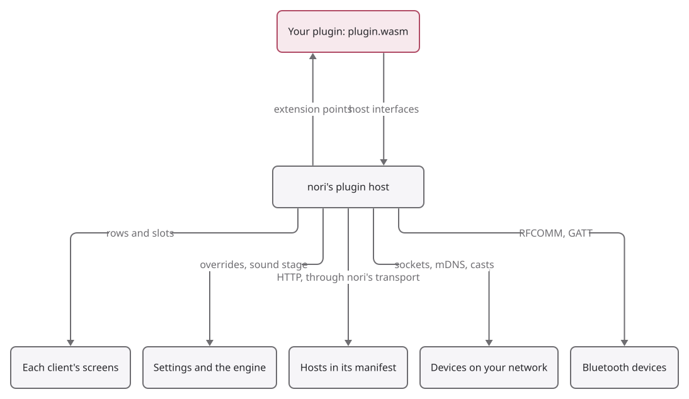

# Plugins

A plugin adds to nori what nori does not ship, such as a music source, a sound effect or controls for
your headphones. It is a WebAssembly component that you write in
Rust with nori's SDK, `nori-plugin-sdk`. nori runs it in a sandbox, and it reaches only what its manifest
declares.

This page says what a plugin can and cannot do. To build one, follow the
[plugin tutorial](plugin-tutorial.md). To look up a field, a row or a limit, see the
[plugin reference](plugin-reference.md).

## How a plugin fits into nori

A plugin is one file, `plugin.wasm`, with its words and an optional icon and README beside it. The
plugin API is the `nori:plugin` WIT package in `wit/`. The plugin exports extension points, which nori
calls. It imports host interfaces, which it calls in nori. The SDK turns both into Rust: a trait for each
extension point, and a module for each host interface.

<picture>
  <source media="(prefers-color-scheme: dark)" srcset="diagrams/plugin-reach-dark.svg">
  
</picture>

The manifest is a Rust constant in the plugin's code. The SDK's `plugin!` macro writes it into the wasm,
and nori reads it before it runs any of the plugin. It names the plugin's id, the hosts it may reach, the
settings it overrides, its rows, and its permissions. The install sheet shows the user what it allows.

## What a plugin can add

A plugin fills one or more extension points, each a trait of the SDK. A method the plugin does not
write answers as nori would on its own, so a plugin writes only what it changes:

| Extension point | What it adds | A plugin of nori's that uses it |
|---|---|---|
| `lifecycle` | Calls when it starts, when a row changes and when an action runs | `playback`, `remote-switch` |
| `hooks` | nori's events: playback, songs, the queue, favorites, outputs, lyric lines, the output picker, timers | `speaker` |
| `provider` | A kind of profile: a music source with its library, search, streams and sign-in | `youtube-music`, `soundcloud` |
| `sound-stage` | A step in the sound chain, on the master or on each song | `orbit` |
| `preparation` | Data made from each song's samples ahead of playback, for its sound stage | None |
| `automix` | Its own song analysis and its own transition plans | None |
| `deciders` | Its answer where nori picks something: shuffle order, autofill, a song's gain, the palette | None |
| `slots` | Menu actions, lines in a song's info, the player's artwork, a line under the player's output | `moving-covers`, `showcase` |
| `device-control` | Battery, noise control and settings for Bluetooth headphones | `sony`, `soundcore` |
| `lyrics` | A lyrics service that nori asks beside its own | None |
| `scrobbler` | A service that hears what you play, beside your server | None |
| `notification` | The buttons on Android's media notification and lock screen | None |

For a provider, also read [Providers](providers.md): it says what nori expects of a music source.

## What a plugin can use

A plugin calls nori's host interfaces. Each one that reaches beyond the plugin's own data needs a line
in its manifest, and the install sheet says so.

- A page of rows that nori draws from the manifest, in each client's own look. nori keeps their values.
- Overrides of nori's settings, and of values with no setting, such as speed, pitch and AutoMix's
  limits. The user's own settings stay as they are, and come back when the plugin is off.
- HTTP to the hosts its manifest names, through nori's own connection pool and proxy.
- A store of 1 MB that nori backs up, a cache up to a quota, and large files (assets) that nori
  downloads on Wi-Fi.
- The session: what plays, the queue, the library and playback controls, each behind a permission. The
  server's Subsonic API, which nori signs, needs a permission too.
- Timers. They fire as often as asked while the plugin runs a cast or controls a device. Otherwise they
  need a permission, and fire at most once per 15 minutes, never while music plays with the screen off.
- Wakes that start nori at boot or when a Bluetooth device connects, and commands that other apps run.
- A sign-in page in the client, for a provider's account.
- The local network: TCP and UDP sockets, mDNS browsing, and HTTP endpoints at nori's LAN address. A
  cast sends nori's audio to a device, or has a device play the songs itself.
- Bluetooth links over RFCOMM or GATT, to the devices its manifest's filters match.
- Notices, which are short lines shown to the user in the plugin's own words, and lines in nori's log.

## What a plugin cannot do

The sandbox holds these rules for every plugin:

- It reads and writes no files. Its data goes in its store, its cache and its assets.
- It reaches no host that its manifest does not name. Private addresses are open only to a plugin that
  names `lan`.
- It never writes the user's settings. It overrides only the keys its manifest lists.
- It never sees the server's password or token. nori signs its Subsonic calls.
- It draws no screen of its own. nori draws its rows and slots.
- It cannot stall nori. Each call has a budget of work. A call that traps or spends it fails, and the
  next call starts a fresh instance. A call that nori waits on, such as a decider's, also has a time limit.
- Its sound stage calls nothing. Every host interface traps there, so the audio never waits for it.
- It grows to at most 256 MB of memory.
- It never runs on each buffer of a cast. nori moves the audio itself.
- It cannot queue a provider song that the user did not ask for, unless the user lets autofill add them.

A Rust plugin's standard library works inside these limits. Randomness and the clocks answer. Files,
stdin, stdout and std's own sockets trap: write to nori's log with the `log` interface.

nori never downloads native code. It compiles each plugin from its wasm at install.

## Which clients run plugins

Every client except the iPod app runs plugins. Some parts need what only some platforms have:

| Client | Runs plugins | What it leaves out |
|---|---|---|
| Android | Yes | Nothing |
| The desktop app | Yes | Notification buttons, wakes, and Bluetooth on Windows |
| The terminal app | Yes | The same as the desktop app |
| The web client | Some | Most extension points and host interfaces |
| The iPod app | No | Every plugin |

The desktop and terminal apps run commands from other apps on Linux only. The web client runs only the
`lifecycle`, `hooks`, `sound-stage` and `slots` extension points. There, a plugin can use its rows, the
settings, its store and cache, HTTP, timers, notices and the log. Its HTTP needs the server that serves
the web client to carry it.

## How plugins reach listeners

Listeners install plugins from a plugin repo: a static `index.json` and its packages, on any web host.
nori lists its own repo, [nori-plugins](https://github.com/norifm/nori-plugins), by default. Users can
add other repos by address, after a warning. A listener can also install a package from a file.

A repo can sign each version with its author's ed25519 key. The first signed version a user installs
pins that key, and every later version must be signed with it. nori updates each plugin from the repo it
came from, at most once a day, unless the user keeps its version.

A plugin is built for one plugin API version, which is 7 in this nori. A nori with another API version
lists the plugin but does not run it until its repo has a build for that API.

## Next steps

- [Build your first plugin](plugin-tutorial.md): a sound effect, from an empty folder to music you hear.
- [Plugin reference](plugin-reference.md): the manifest, rows, strings, packages, permissions, limits
  and repos.
- [The plugin host](plugin-host.md): how nori installs, checks, compiles and runs plugins.
- nori's plugins are working examples: in [nori-plugins](https://github.com/norifm/nori-plugins),
  `youtube-music` for a provider and `sony` for device control; in
  [nori-dev-plugins](https://github.com/norifm/nori-dev-plugins), the plugins for developers, `orbit` for
  a sound stage, `speaker` for a cast and `showcase` for every slot and kind of row.
