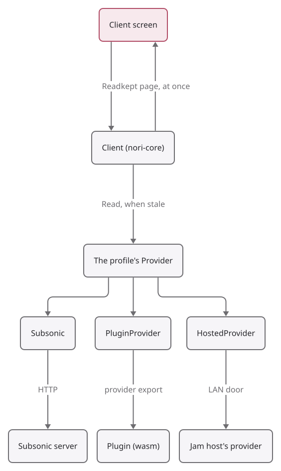

# Providers

A provider is where a profile's music comes from. It is a Subsonic server (Navidrome, octo-fiesta), the
music files on the device, or a plugin's provider export (YouTube Music and SoundCloud are plugins). Each provider is one
implementation of the `Provider` trait in `crates/core/src/providers/`. Nothing else in the core, the
engine or a client names a provider. They ask the profile's provider, and they draw what it describes.

Every client opens Subsonic profiles. Android, the desktop app, the terminal app and the iPod app open
local files ([Local files](#local-files)). Android, the desktop app and the terminal app also open plugin
providers.

A provider here is not an octo-fiesta provider song (an `ext-` id that a Subsonic server fetches from a
streaming service). Those are songs of a Subsonic profile.

<picture>
  <source media="(prefers-color-scheme: dark)" srcset="diagrams/provider-read-dark.svg">
  
</picture>

## The providers

The core has four providers:

| Provider | Module | Built by |
|---|---|---|
| `Subsonic` | `providers/subsonic/` | Every client |
| `Local` | `providers/local/` | Every client, offered where the client gives the device's files |
| `PluginProvider` | `providers/plugin.rs` | The `plugins` feature of `nori-core`: Android, the desktop app, the terminal app |
| `HostedProvider` | `providers/hosted.rs` | Every native client |

`PluginProvider` answers the trait through the plugin's `provider` export in `wit/plugin.wit`. See
[Plugins](plugins.md) for the plugin side.

`HostedProvider` is the provider of a LAN jam's guest profile. It sends the guest's reads and stream
lookups to the host's door. The host answers them with its own provider. The guest then fetches the
resolved stream URLs itself. So a guest needs neither the host's plugin nor its account.

The reverse direction is `providers/plugged.rs`: it gives plugins the open profile (its queue, its
library and its Subsonic API). Every client hands the profile's client over with `Kinds::open_client`.

## The kinds a client offers

A client makes one `Kinds` and hands it to every `Core` it opens. `Kinds::builtin` has only Subsonic.
`Kinds::with_plugins` adds the providers of the plugins that run, over the plugin host.
`Kinds::set_files` (or `Kinds::set_device_music` from Kotlin) adds local files. A client that cannot read
the device's files never calls it, so the core never offers the kind there.

`Kinds::providers` lists the kinds that can be added, in order. Subsonic comes first. Then comes each
running plugin whose manifest extends `provider`. A plugin kind is named by the plugin's own `name`
word, through `Kinds::plugin_name`.

### A profile whose plugin does not run here

A saved profile of a plugin kind does not open while its plugin does not run on this client.
`Kinds::waits` says what the profile waits for, as a `ProfileWait`:

| `ProfileWait` | The profile opens after |
|---|---|
| `Install` | the plugin is installed |
| `Update` | the plugin is updated to a version this nori runs |
| `TurnOn` | the plugin is turned on |
| `PluginsOn` | the switch over all plugins is turned back on |
| `NoPlugins` | never: this client runs no plugins |

The client shows the wait in place of the profile and opens the profile once its plugin runs.

A LAN jam's guest profile never waits. It keeps the host's kind, because its songs are that provider's,
but it plays through the host. `Core::configure_profile` gives it a `HostedProvider`.

`ServerKind::from_id` reads the stored kind `youtubeMusic` as a profile of the `fm.nori.youtube-music`
plugin, without its user name. The user signs in again through the plugin.

## What a provider answers

`Core::configure_profile` makes one provider instance per profile it opens. The instance can hold that
profile's state, such as a session or streams it resolved. Its methods get the `Client` they work
through. Many methods have defaults, so a provider writes only what it has.

| Method | What it answers |
|---|---|
| `info` | The add form's fields (`FieldSpec`) and the ways the account signs in (`SignIn`) |
| `ready` | Whether the add form can be sent |
| `check` | The checked profile to keep, after asking the server |
| `rules` | The profile's `ProfileRules`, also for a jam guest |
| `configure` | Points the `Core` at the profile: its library key, rules and account |
| `subsonic_api` | Whether a Subsonic server takes the core's account work |
| `favorites_here` | Whether favorites the account cannot keep stay on this device |
| `keeps_favorites` | Whether the account keeps favorites of one item kind |
| `read` | One `Read` asked of the source now, as an `Answer` |
| `read_in_parts` | `read`, sending what the source shows of its answer before the whole (a plugin's `parts`) |
| `parse` | A raw answer (`Answer::Raw`) read as its `Page` |
| `scope` | What else an answer depends on, such as a server's music folders |
| `gone` | Whether an error means the item is gone |
| `write` | Sends one change: a favorite, a playlist edit, the rest of `Write` |
| `stream` | A song's stream address and its cache key (`StreamTarget`) |
| `ahead` | How many songs past the next one may be fetched ahead |
| `cover_address` | A cover's URL at a size |
| `cover_prefix` | The start every cover URL shares, if any |
| `cover_sizes` | The sizes its image server keeps ready, for covers that are URLs already |
| `resolver` | A `ResolveStream` that turns stream addresses into URLs |
| `file` | The file on this device a song plays from, whatever its stream says |
| `sync` | Fills the offline index from the source (`Client::sync_library`) |
| `sync_progress` | How far a sync running is, where it can say |
| `sign_in_done` | Whether a sign-in page at an address, with its cookies, is done |
| `sign_in` | Signs the account in with what the page or the user handed over |
| `start_code` | A code that the user allows in a browser (`SignIn::Code`) |
| `check_code` | How the code stands, signing in once allowed |
| `sign_out` | Signs the account out on this device |
| `account` | Where the account stands (`AccountState`) |
| `reminds_to_sign_in` | Whether the client reminds the user to sign in after the session ended |
| `stop_reminding` | Stops the reminder until the next ended session |
| `account_picture` | The signed-in account's picture |
| `identities` | Who the account may act as, such as a Google account's YouTube channels |
| `choose_identity` | Switches the account to one of those identities |

Without `subsonic_api`, the core's account work fails at once. That work is scrobbles, playlists,
queue pushes and remote control.

### Streams that need resolving

A provider whose stream addresses are not URLs gives a `ResolveStream`. The client wraps the engine's
byte source with `nori_engine::core::resolving`. That wrapper asks the resolver for the URL each address
opens at, and resolves the address again after a refusal. A resolver can also do three more things:

- `live` serves a live stream as one body.
- `resolve_rest` gives one URL for the rest of a download.
- `parts` asks a slow server in parts (`StreamParts`).

The byte source reads a URL served as an HLS media playlist as one stream of its segments
(`crates/engine/src/hls.rs`).

## What the core does for every provider

A provider only fetches and sends. The page store in `crates/core/src/cache_policy.rs` does the rest,
the same way for every provider:

- The store keeps each page under nori's own key for its read. Most reads stay fresh for two minutes.
- A raw answer (`Answer::Raw`, a Subsonic server's) is kept on disk and parsed again on every read. A
  `Page` answer is kept in memory for the session. An album, artist, artist about or playlist `Page` is
  also saved on disk for later sessions (see [Saved pages](#saved-pages)).
- `Client::read_stored` returns the kept page at once. `Client::read_fetch` asks the source and returns
  a page only when it changed.
- `Client::read_each` shows the kept page, then the source's. With no kept page, it also shows each part
  the source shows before its whole answer comes (see [A playlist shown in parts](#a-playlist-shown-in-parts)).
  A part is never kept.
- The session's favorite marks are laid over every page as it is read. An item unmarked this session
  leaves the favorites. An item marked this session joins them before the source lists it.
- A write makes the pages of its kind stale (`cache_policy::stale`). Stale pages still show, offline
  too, until the source answers again.
- Home stays as first shown for the whole session. A refresh merges the new feed into it, so nothing
  that shows moves.

### Saved pages

The core saves a `Page` answer of an album, an artist, its about part or a playlist on disk
(`Saved` in `cache_policy.rs`). The `cache` table holds it under `saved:` and its kept key, with the
page's digest. The next session
shows the saved copy at once and asks the source again, once, as the page opens. The same answer shows
nothing more. A changed one replaces the copy, and the clients move its items with the core's
`pages::row_keys` and `pages::newer_places`. Home has its own saved copy (`home_saved_key`).

- A saved copy is only a page's last answer. It is never indexed, so it never reaches search, the library
  or autofill.
- A profile keeps its 200 latest saved pages, each for 30 days. A write made while the read was on its
  way stops the save, as it stops the memory copy.
- Signing out drops the saved pages and Home's. Removing the profile drops its rows with the rest.

### A playlist shown in parts

A provider that reads a long playlist page by page sends each part to `Provider::read_in_parts`
(a plugin's `parts.show-playlist`). `Client::read_each` shows each part with `PlaylistDetail::filling`
set, and tells the queue how far the page came (`queue::Session::page_listed`).

A queue started from a part follows the page (`nori_queue::follow`): `QueueChange::follows` is set, and
autofill waits. The platform then calls `Client::queue_follow`, as it calls autofill. The core waits for
the page's read on its way (`Client::turn`), or reads it again if that read ended first. The songs after
those the queue had join its end: in order, or shuffled among the songs not played yet. The host and
Android's `PlaybackService` make the same change to the player (`Followed::edit`). A queue started since
takes nothing.

### Favorites kept on this device

Some accounts cannot keep favorites: a plugin's provider while signed out, or one without an account.
For them the core keeps favorites on this device (`ProfileRules::stars_here`,
`crates/core/src/favorites.rs`). `Client::star` then stores enough of the item to draw its row and open
it, in the `favorites_here` table, and sends nothing. The favorites list shows the source's favorites
first, then those kept here, each item once.

Once the account signs in, new seals go to the account. An item kind the account has nowhere for
(`Provider::keeps_favorites` answers false) stays on this device while signed in too. Favorites kept
here are not indexed or synced. They go with the profile when it is removed, and a backup holds them.

## A profile of several sources

A profile can play from more sources than its own and browse them as one library. Its
`SavedServer::sources` lists other saved profiles, in order. A profile listed there is a source, not a
profile of its own, so `settings::servers_shown` leaves it out of the profile lists. A client adds a
source on the profile's Edit page: a saved profile from `providers::sources_offered`, or a new one signed
in to there. `settings::servers_source_added` keeps the edited profile in use.

When a profile opens, the client opens each source with `Core::open_source`. A source gets a `Core` and a
`Client` of its own. Its provider, account, kept pages, favorite marks and queued writes stay that
source's. The profile's queue and saved queue stay the profile's.

Each song, album, artist and playlist from another source carries that source's id in `source`. An item
of the profile's own source has none, so a profile of one source reads, stores and plays as before.
`crates/core/src/sources.rs` routes on that field:

| What | Where it goes |
|---|---|
| A list read (search, artists, playlists, favorites, genres, songs) | Every source, merged into one page |
| An album list, a page at a time | Every source, each read on from where it stopped (`merged::ListMerge`) |
| An artist's page | Its source, then the same artist in every other source, as one page |
| An item's own page (`read_each_in`, `read_now_in`, `PageAsk`, `Fetch`), a song's share link | The item's source |
| A playlist's page, songs and changes (`PlaylistAt`, `Client::playlist_change`) | Where the playlist is kept |
| A favorite (`star_in`) | The item's source |
| A song's stream, its resolver and how far ahead it is fetched | The song's source |
| A play's scrobble and now playing | The song's source, and the profile's scrobbling accounts |
| What may be done with an item (`Core::rules_of`) | The item's source's rules |

### Rows kept per source

A source's rows in the database carry its saved id in `server`, which is the value items carry in
`source`. The profile's connection lists its other sources in a temporary table, and reads that span
them use `db::IN_PROFILE`. A song, album or artist read from the database takes its `source` from its
rows. A row of the profile's own reads as before.

- A play is recorded in the rows of its song's source (`Session::source_opened`). The history and the
  listening statistics read every source's plays.
- A download goes into the rows of its song's source, where that source's rules keep downloads. The
  downloads lists read every source's.
- The mixes draw from the profile's own songs and from the sources whose rules have mixes
  (`db::IN_MIXES`). A song left out of the mixes is kept in its source's rows
  (`Core::mix_excluded_set`).

### Home

A profile of several sources has one Home. Its rows read every source, and the Homes of the sources that
have their own (`ProfileRules::feed`) come after one another as one feed. `home::home_woven` gives the
order: a row and a feed shelf in turns. A shelf that holds at least half of the shelf before it is left
out. The host sends that order as `HomePart::Places`.

### Playlists

A source's playlists stay that source's, and take only that source's songs. nori's own playlists hold
songs of any source and are kept on the device, in the profile's rows (`mixed_playlists.rs`). Each song is
kept whole, with its source, and is never indexed. They come first in the Playlists list.

- `PlaylistAt` says where a playlist is kept: in a source, or on the device. A client opens and plays a
  playlist by its id and `PlaylistAt` (`Client::read_playlist`, `Client::playlist_songs_at`).
- `Client::playlist_change` adds, moves, removes, renames and deletes, where the playlist is kept. A song of
  another source is not added to a source's playlist: the answer is `PlaylistChanged::Refused` with
  `PlaylistRefusal::OtherSource`, and nothing is sent. Each client says in words that the playlist is on
  that source and takes only its songs.
- `Client::playlist_choices` offers nori's own first, then every source's playlists that the account may
  change. Those that do not take the songs come last, with the same `refused`.
- `Client::playlist_create` keeps a new playlist where `Client::new_playlist_in` says: in the songs' one
  source when it makes playlists, else as nori's own.

### Songs in the queue

A queued song is its key: `ItemKey`, its source and its id (`crates/player/src/key.rs`). The playlist's
entries, the queue's song store, the engine's streams and plans, the planner's window and the downloads
all hold keys, so one id in two sources is two songs. A song of the profile's own source has `source`
None.

Each part goes to the song's source by its key:

- `Client::resolve` asks the source's client for the stream address, at that source's quality.
- Analyses, vocal curves and plays live in the source's rows. `db::Profile::rows` gives the connection
  for a source.
- A download's row is kept in its source's rows. `db::of_key!` and `db::key_params` find a key's row.
- Lyrics are looked up through the source's client. A scrobble and now playing go to the song's source.

A key becomes one string only where a value must cross as a string. Those are media3's item id, a
download's id, a cache key, the iPod's and the web's song ids, and a cover id of another source.
`ItemKey::text` writes it and `ItemKey::from_text` reads it. Only Android's `Library.coverUrl` splits one
too, and its twin holds it to the Rust. For the profile's own source the text is the id alone. Stream cache keys
(`stream_cache_key`), download keys (`download_key`), the saved queue and every stored row of a profile
of one source keep the values they had.

Over FFI the key is a record (`source`, `id`). Kotlin builds it from a song's fields. It turns a list of
keys into media ids and back with `item_key_texts` and `item_keys_of`, one call per list. The iPod's and
the web's song rows carry the text as `key`, and the apps compare and send it as it is.

Other devices hear of the profile's own songs alone (`ItemKey::own_id`): the server's play queue, a
controlled device, a jam's lyrics and transitions.

### Covers

`Keyed::of_source` makes an item another source's. It sets `source`, and its `cover_art` becomes the
cover's key text (`ItemKey::text` of the source and the cover's id). It runs in `stamped` for a source's
pages, in `songs_of_source` for its songs, and in `items::song`, `items::album` and `items::artist` for
rows read from the database. So a cover id that goes on alone still names its source: a mix's tiles, the
queue's covers, the car's art, a download's notice. The profile's own covers keep their ids.

- `Core::cover_address` makes a cover's URL with the provider of the source the id names. The host's
  clients (the desktop app, the terminal app, the iPod app, the web) load every cover through it.
- Android builds URLs itself from `Core::cover_prefixes`, one prefix for each source. It splits the id at
  `CoverRules::source_mark` (`Library.coverUrl`, twin in `CoreTwins.kt`).
- A row keeps the cover's own id (`nori_model::cover_id`), and its `server` names the source.
- The cover cache keys a cover by its URL's host, path and id, so two servers' covers of one id are two
  covers. Two accounts of one server share their covers, as the server does.

### Favorite marks

Each source's core keeps this session's marks of its own items (`stars::Marks`). A client is handed the
profile's marks whole, each item by its key (`stars::StarMarks`, made by `Core::star_marks`), and looks a
seal up there with `StarMarks::starred`. So one id in two sources is two marks.

- `Client::star_in` marks the item in its source's core and hands the client the profile's marks at
  once. If the source refuses, the mark from before comes back, and the client is handed the marks again.
- A source's pages are laid over with that source's marks alone. A page kept for offline shows them too.
- `Core::starred_in` answers for one item. The desktop app and the iPod app ask it for each row.
- Another device's queue holds the profile's own songs alone. A seal of another source's song is never
  read from that queue or sent there (`Remote::star_where_playing`).

### Remote control and jams

No one server has every source. So a profile of several sources reaches other devices over the LAN alone
(`Core::lan_only`), as a profile with no server does. Jams open on the LAN door, and pairing is by
code or link. A guest reads through its host, across the host's sources. A queue sent to a controlled
device is refused while it holds another source's song (`Refusal::OtherSource`).

### One copy of an item

`nori_library::merged` decides when two sources' items are one, strictly: a wrong merge hides a song.

- Two songs are one when both have a MusicBrainz id and the ids match. Without an id on both, their title,
  artist and album must match, case and spaces aside. Their lengths must also be known and at most 2 s
  apart.
- Two albums are one on matching MusicBrainz ids. Otherwise their name and artist match, and their year
  and song count match where both give them.
- Two artists are one when their names match.

The listener's own library wins: the copy from a source that `Provider::holds` `SourceKind::Library` (a
Subsonic server) shows over a service's. A server's `ext-` item is a service's. Between two of a kind,
the first source's copy shows. Items that are not one both show, each with its own `source`.

A client shows an item's source only beside a look-alike from another source in the same list. A
look-alike has the same name and artist, but is not the same item. The core sets `source_marked` on each
item that shows its source (`merged::marked`). It does so where it merges a list: `merged`,
`ListMerge::page`, a playlist of nori's own and the queue's view.

The mark is the source profile's circle, as the profile lists show it: its picture, icon, face or letter.
A client draws it small, in the bottom corner of the item's cover. It sits on a plate of the page's paper.
The plate is centred on the corner's arc, so its edge follows the corner. On a round cover, it sits inside
the edge. It never takes the accent. `settings::source_profile` names the saved profile of an item's
`source`.

| Client | The mark |
|---|---|
| Android | `SourceCorner` in `Cover` (`ui/Components.kt`) |
| The desktop app | the `Art` component's corner, its mark from the `SourceMarks` global |
| The iPod app | `CoverView.showSource`, from an item's `mark` |
| The terminal app | the source profile's letter before the name, as `‹N›` |

## What a client does

A client asks the core and draws the answer, the same way on every client.

- **The first screen** lists `Kinds::providers` in order. Below them, less prominently, it lists
  `nori_plugins::provider_offers`: providers that plugin repos offer and that are not on.
- **Adding a profile** is `providers::flow::AddFlow`. The client hands it each `AddEvent`, draws the
  `AddPage` that results, and does the `AddDo` it answers. Choosing an offered plugin opens its plugin
  page to install it, and choosing one that is off turns it on. A kind's `FirstStep` says whether its
  page is a form, a sign-in (`Account`), or nothing (`AddNow`). One profile is on its way at a time.
- **Logging in** is `providers::log_in`. It runs `Kinds::login_profile`, then `Kinds::check_profile`,
  and keeps the profile as the active one. A login to a saved server's address and user is that saved
  profile again. A login saves only what the form holds. The rest of a saved profile stays as it is saved
  at that moment: its music folders, bitrate cap, icon, account, scrobbling and sources. Other pages
  change these while a profile's Edit form is open.
- **Opening a profile** asks `Kinds::waits` first, for a plugin's profile. It then calls
  `Core::configure_profile` and wraps the engine's byte source with `nori_engine::core::resolving`.
- **The account.** `Client::sign_in_due` says what to show once a profile opens or its account changes.
  After adding, it is the sign-in offer, and after adding as a guest, nothing. After the provider ended
  the session, it is the offer again, until the user stops the reminder. `providers::flow::SignInFlow`
  holds what shows, one dialog at a time.
- **Covers.** A client builds cover URLs from `Core::cover_prefixes`, with the id and size appended.
  A cover id of another source names that source and takes its prefix ([Covers](#covers)). Without a
  prefix, the client asks `Core::cover_address` for each cover.

### Signing in

Each `SignIn` way needs its own screen in every client:

- `SignIn::WebPage` opens a page of the app's own at `start_url`. The page reports each address it
  shows, with its cookies, to `Kinds::sign_in_done`, and each address it refuses to open, such as an
  OAuth redirect. Once that answers done, the cookies go to `Client::sign_in`.
- `SignIn::Code` shows the code large, with a button that opens its page in the system browser and one
  that copies it. `Client::sign_in_with_code` checks the code on its own thread
  (`providers::code::CodeSignIn`), and its events go to the flow. An expired code offers a new one.
- `SignIn::Paste` shows a box to paste into.

### Words for each kind

A client's only code for each provider is its words. Each client keeps one entry per kind:

| Client | Where |
|---|---|
| Android | `providerWords` in `android/app/src/main/kotlin/dev/nori/music/app/ui/Say.kt` |
| The desktop app | `words::provider` in `crates/desktop/src/words.rs` |
| The terminal app | `text::provider` in `crates/cli/src/text.rs` |
| The iPod app | `Say.provider` in `ios/Sources/Say.swift` |

## Local files

A local profile plays the music files on the device. Its provider answers every read from the offline
index, and a sync fills the index from the files. The crate `nori-local` finds the files, reads them and
builds the library. `providers/local/` keeps it in the index and answers the reads.

### Where the files come from

The client gives the core a `nori_local::Files`. It says where the files are (`MusicPlace`), lists them
and opens them. A song plays through the same opener (`SongFile`, the engine's `Source::Opened`), so a
browser's file plays as a file on disk does.

| Client | `Files` | `MusicPlace` |
|---|---|---|
| Android | `MediaLibrary` (MediaStore, behind the music permission) through `DeviceMusic` | `Device` |
| The desktop app, the terminal app | `Disk::folders`: the folders the profile names, at first this computer's Music folder (`nori_local::music_folder`) | `Folders` |
| The iPod app | `Disk::device`: the app's Documents folder, filled through file sharing | `Device` |
| The web client | `WebFiles` in `crates/web/src/files.rs`: the files of a folder the page picked, read with `FileReaderSync` | `Device` |

Adding a local profile asks nothing, so its kind's first step is `AddNow`. With `Folders`, `check` gives a
profile that names no folders the platform's own (`Files::default_folders`). Only a saved profile's form
shows `FormField::Folders`. In its sheet, the desktop app adds a folder through the system's folder picker
(`rfd`) and takes one off. Android asks for the music permission as the kind is chosen. The web page asks
for a folder, the only pick a browser forces.

A browser keeps no path. The page walks the folder and hands its `File`s to the worker
(`Nori::local_files`), each visit. With the File System Access API, the page keeps the folder's handle in
IndexedDB by the profile's id. At the next visit it reads the folder again if the browser still allows
it. Otherwise Home shows a row that asks for the folder again (`web/src/state/folder.svelte.ts`).

Sometimes the files can't be read at all: a folder is gone, a drive is unplugged, or the permission is
not given. Then `Files::list` returns None and the sync changes nothing. The library, its seals and its
plays stay until the files can be read again.

### A sync

`Client::sync_library` runs the scan in `providers/local/scan.rs`:

1. It lists the files and compares them with the `local_files` table: path, size and time. A file kept
   with the same size and time is not read again.
2. It reads each new or changed file with `nori_local::tags::read`. It reads the tags, the audio's
   length and format, and a fingerprint of the first audio packets. A file without audio that nori
   decodes is kept as left out. It is not read again until it changes.
3. When anything changed, `nori_local::group` builds the songs, albums and artists from every kept file.
   They replace what the index held, and seals carry over.

Nothing changed, nothing is written. A local profile's rules have `rescans`, so the session syncs it each
time the profile opens and each time the app comes back into sight. The web syncs it as its folder is
handed over. Nothing watches the files. In a browser, the scan gives the worker's thread back every few
files, so pages and playback go on.

### A song's identity

A song is its row in `local_files` (`local-<row>`), not its path. A file that moved or was renamed is
known again by its fingerprint. The fingerprint hashes the audio packets, never the tags, so a file moved
and retagged at once is still the same song. Its plays, its seal and its AutoMix measurements stay. Two
copies of one recording are two songs. A file whose audio changed in a new place is a new song.

### Albums, covers and playlists

An album is its songs with one album name and album artist. Songs without an album artist are grouped by
their folder, and a folder named as a disc ("CD 2") counts as its parent. Songs of one such album by
different artists make a compilation. A folder's picture (`cover.jpg`, `folder.jpg` and the like) is its
album's cover, else the picture a file holds. A cover's address comes from `Files::cover_address`.
Natively it is `file://` and the path, which the cover loader reads in place (`nori_local::cover_bytes`).
In a browser it is a blob address of the picture. `.m3u` files are playlists, read only.

Android lists only music, as the music permission lets it read nothing else. MediaStore reads the rest
itself. An album with no picture of its own takes MediaStore's (`Files::album_art`), which comes from its
folder (`cover.jpg`, `folder.jpg`) where the files hold none. The app keeps it under `local-covers/`.
MediaStore's playlists are the `.m3u` files in the music folders (`Files::playlists`). Other players ask for
more to read folder pictures: foobar2000 asks for `READ_MEDIA_IMAGES`, and Auxio reads folders the user
grants through the system's picker.

### What a local profile does not do

- It has no account, no downloads and no radio. Scrobbling accounts work, and nothing is scrobbled to a
  server.
- Remote control works. Songs never go to another device: `Refusal::DeviceFiles` refuses them, either
  way.
- A LAN jam's guest cannot listen along: the host resolves no stream for it.

## Add a provider

A provider for a service that nori does not ship is a plugin with a `provider` export. See
[Plugins](plugins.md).

To build a provider into nori:

1. In `crates/settings`, add a `ServerKind` variant. Give it the name its profiles are stored under, in
   `ServerKind::id` and `ServerKind::from_id`.
2. Write its `Provider` as one module under `crates/core/src/providers/`.
3. Add it to `Kinds::provider` and `Kinds::kinds`.
4. Put a wire format in a crate of its own, with no nori dependencies.
5. If not every client builds it, put it behind a `nori-core` feature.
6. Add its words to each client's table above.

The forms, sign-in, pages, playback and rules follow from what the provider answers. Nothing else
changes.

## Tests

- `providers/harness.rs` runs one scripted session per provider. It compares each step's pages,
  freshness and requests with a recorded transcript in `crates/core/tests/golden/`. `NORI_BLESS=1`
  records the transcript again.
- `providers/fake.rs` is a test-only provider that stands in for a third kind. Its tests search, open a
  page, play, show covers and sign in through the generic paths, with no provider named.

Run them with `cargo test -j4 -p nori-core`.
