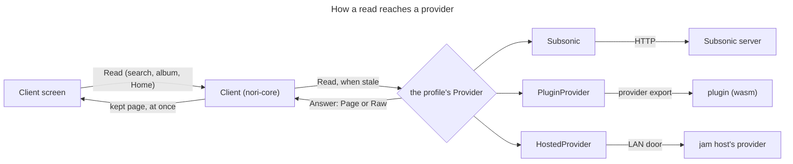

# Providers

A provider is where a profile's music comes from: a Subsonic server (Navidrome, octo-fiesta) or a
plugin's provider export (YouTube Music and SoundCloud are plugins). Each provider is one
implementation of the `Provider` trait in `crates/core/src/providers/`. Nothing else in the core, the
engine or a client names a provider. They ask the profile's provider, and they draw what it describes.

Every client opens Subsonic profiles. Android, the desktop app and the terminal app also open plugin
providers. The web client and the iPod app open only Subsonic profiles.

A provider here is not an octo-fiesta provider song (an `ext-` id that a Subsonic server fetches from a
streaming service). Those are songs of a Subsonic profile.

## The providers

The core has three providers. The table lists where each one lives and which clients build it.

| Provider | Module | Built by |
|---|---|---|
| `Subsonic` | `providers/subsonic/` | Every client |
| `PluginProvider` | `providers/plugin.rs` | The `plugins` feature of `nori-core`: Android, the desktop app, the terminal app |
| `HostedProvider` | `providers/hosted.rs` | Every native client |

`PluginProvider` answers the trait through the plugin's `provider` export in `wit/plugin.wit`. See
[Plugins](plugins.md) for the plugin side.

`HostedProvider` is the provider of a LAN jam's guest profile. It sends the guest's reads and stream
lookups to the host's door. The host answers them with its own provider. The guest then fetches the
resolved stream URLs itself. So a guest needs neither the host's plugin nor its account.

The reverse direction is `providers/plugged.rs`: it gives plugins the open profile (its queue, its
library and its Subsonic API). Every client hands the profile's client over with `Kinds::open_client`.

## The kinds a client offers

A client makes one `Kinds` and hands it to every `Core` it opens. `Kinds::builtin` has only Subsonic.
`Kinds::with_plugins` adds the providers of the plugins that run, over the plugin host.

`Kinds::providers` lists the kinds that can be added, in order. Subsonic comes first. Then comes each
running plugin whose manifest extends `provider`. A plugin kind is named by the plugin's own `name`
word, through `Kinds::plugin_name`.

### A profile whose plugin does not run here

A saved profile of a plugin kind does not open while its plugin does not run on this client.
`Kinds::waits` says what the profile waits for, as a `ProfileWait`:

| `ProfileWait` | The profile opens after |
|---|---|
| `Install` | the plugin is installed |
| `Update` | the plugin is updated to a version this nori runs |
| `TurnOn` | the plugin is turned on |
| `PluginsOn` | the switch over all plugins is turned back on |
| `NoPlugins` | never: this client runs no plugins |

The client shows the wait in place of the profile and opens the profile once its plugin runs.

A LAN jam's guest profile never waits. It keeps the host's kind, because its songs are that provider's,
but it plays through the host. `Core::configure_profile` gives it a `HostedProvider`.

A YouTube Music profile saved while YouTube Music was built in has the stored kind `youtubeMusic`.
`ServerKind::from_id` reads it as a profile of the `fm.nori.youtube-music` plugin, without its old user
name. The user signs in again through the plugin.

## What a provider answers

`Core::configure_profile` makes one provider instance per profile it opens. The instance can hold that
profile's state, such as a session or streams it resolved. Its methods get the `Client` they work
through. Many methods have defaults, so a provider writes only what it has.

| Method | What it answers |
|---|---|
| `info` | The add form's fields (`FieldSpec`) and the ways the account signs in (`SignIn`) |
| `ready` | Whether the add form can be sent |
| `check` | The checked profile to keep, after asking the server |
| `rules` | The profile's `ProfileRules`, also for a jam guest |
| `configure` | Points the `Core` at the profile: its library key, rules and account |
| `subsonic_api` | Whether a Subsonic server takes the core's account work |
| `favorites_here` | Whether favorites the account cannot keep stay on this device |
| `keeps_favorites` | Whether the account keeps favorites of one item kind |
| `read` | One `Read` asked of the source now, as an `Answer` |
| `parse` | A raw answer (`Answer::Raw`) read as its `Page` |
| `scope` | What else an answer depends on, such as a server's music folders |
| `gone` | Whether an error means the item is gone |
| `write` | Sends one change: a favorite, a playlist edit, the rest of `Write` |
| `stream` | A song's stream address and its cache key (`StreamTarget`) |
| `ahead` | How many songs past the next one may be fetched ahead |
| `cover_address` | A cover's URL at a size |
| `cover_prefix` | The start every cover URL shares, if any |
| `resolver` | A `ResolveStream` that turns stream addresses into URLs |
| `sign_in_done` | Whether a sign-in page at an address, with its cookies, is done |
| `sign_in` | Signs the account in with what the page or the user handed over |
| `start_code` | A code that the user allows in a browser (`SignIn::Code`) |
| `check_code` | How the code stands, signing in once allowed |
| `sign_out` | Signs the account out on this device |
| `account` | Where the account stands (`AccountState`) |
| `reminds_to_sign_in` | Whether the client reminds the user to sign in after the session ended |
| `stop_reminding` | Stops the reminder until the next ended session |
| `account_picture` | The signed-in account's picture |
| `identities` | Who the account may act as, such as a Google account's YouTube channels |
| `choose_identity` | Switches the account to one of those identities |

Without `subsonic_api`, the core's account work fails at once. That work is scrobbles, playlists,
queue pushes and remote control.

### Streams that need resolving

A provider whose stream addresses are not URLs gives a `ResolveStream`. The client wraps the engine's
byte source with `nori_engine::core::resolving`. That wrapper asks the resolver for the URL each address
opens at, and resolves the address again after a refusal. A resolver can also do three more things:

- `live` serves a live stream as one body.
- `resolve_rest` gives one URL for the rest of a download.
- `parts` asks a slow server in parts (`StreamParts`).

The byte source reads a URL served as an HLS media playlist as one stream of its segments
(`crates/engine/src/hls.rs`).

## What the core does for every provider

A provider only fetches and sends. The page store in `crates/core/src/cache_policy.rs` does the rest,
the same way for every provider:

- The store keeps each page under nori's own key for its read. Most reads stay fresh for two minutes.
- A raw answer (`Answer::Raw`, a Subsonic server's) is kept on disk and parsed again on every read. A
  `Page` answer is kept in memory for the session.
- `Client::read_stored` returns the kept page at once. `Client::read_fetch` asks the source and returns
  a page only when it changed.
- The session's favorite marks are laid over every page as it is read. An item unmarked this session
  leaves the favorites. An item marked this session joins them before the source lists it.
- A write makes the pages of its kind stale (`cache_policy::stale`). Stale pages still show, offline
  too, until the source answers again.
- Home stays as first shown for the whole session. A refresh merges the new feed into it, so nothing
  that shows moves.

### Favorites kept on this device

Some accounts cannot keep favorites: a plugin's provider while signed out, or one without an account.
For them the core keeps favorites on this device (`ProfileRules::stars_here`,
`crates/core/src/favorites.rs`).

`Client::star` then stores the item's record in the `favorites_here` table: its title, artist, album
and cover, enough to draw its row and open it. It sends, queues and streams nothing. The favorites list
shows the source's favorites first, then those kept here, each item once.

Once the account signs in, new seals go to the account. An item kind the account has nowhere for
(`Provider::keeps_favorites` answers false) stays on this device while signed in too. YouTube Music
albums and artists are kept this way. Favorites kept here are not indexed or synced. They go with the
profile when it is removed, and a backup holds them.

## What a client does

A client asks the core and draws the answer. The steps below are the same on every client.

### The first screen

A new profile starts on the first screen. It lists `Kinds::providers` in order, then, less prominently,
`nori_plugins::provider_offers`: providers that plugin repos offer and that are not on. A repo that
cannot be read offers nothing. With every plugin off, no plugin is offered.

The pages of adding a profile are `providers::flow::AddFlow`. The client hands it each `AddEvent`, draws
the `AddPage` and `AddSend` that result, and does the `AddDo` it answers:

- Choosing a plugin that is not installed opens its plugin page (`AddPage::Offered`). Once its install
  begins (`AddEvent::InstallBegan`), the first screen shows it installing (`AddPage::Installing`). Once
  installed, it is turned on and chosen. A refused install shows its page again.
- Choosing a plugin that is installed but off turns it on.
- Choosing a kind runs `ProviderInfo::first_step`. Its `FirstStep` says what the kind's page shows:
  - `Form`: a form with fields to fill. A name field alone does not count.
  - `Account`: the sign-in and **Continue as guest**, for a kind with no fields but a sign-in page or
    code.
  - `AddNow`: nothing. The profile is added at once (`AddDo::Connect`), and its page shows only if that
    fails.
- One profile is on its way at a time. The flow learns how a new profile was asked for (`AfterAdding`)
  only when the profile is accepted (`AddDo::Open`).
- Back from a kind's page returns to the first screen.

### The add form and logging in

The form shows the chosen kind's `ProviderInfo` fields, with the advanced ones folded away.
`Kinds::server_ready` says whether it can be sent.

`providers::log_in` runs `Kinds::login_profile`, then `Kinds::check_profile`, and keeps the profile as
the active one. A login to a saved server's address and user is that saved profile again. A kind that
asks no address, such as a service's account, gets a new profile for each login.

### Opening a profile

For a plugin's profile, the client asks `Kinds::waits` first. It then calls `Core::configure_profile`
and wraps the engine's byte source with `nori_engine::core::resolving`.

### The account

`Client::sign_in_due` says what to show once a profile opens or its account changes:

| Moment | What shows |
|---|---|
| After adding | The sign-in offer, or its page |
| After adding as a guest | Nothing, and no reminders after that |
| The provider ended the session | The offer again, until the user stops the reminder |

`Client::sign_in_offer` is the offer when the user asks for it, for example from a seal tapped while
signed out. `providers::flow::SignInFlow` holds what shows, one dialog at a time, and the sign-in on its
way. `Client::account` says where the account stands.

### Signing in

Each `SignIn` way has its own screen:

- `SignIn::WebPage` opens a page of the app's own at `start_url`. The page reports each address it
  shows, with its cookies, to `Kinds::sign_in_done`. It also reports each address it refuses to open,
  such as an OAuth redirect to an app's own address. Once `Kinds::sign_in_done` answers done, the
  cookies go to `Client::sign_in`.
- `SignIn::Code` shows the code large, with two buttons. One opens the code's page in the system
  browser, and one copies the code. `Client::sign_in_with_code` asks for the code. It checks the code on
  its own thread (`providers::code::CodeSignIn`) while `SignInFlow::checks_code` holds, and its events
  (`CodeShown`, `CodeExpired`, `Answered`) go to the flow. An expired code offers a new one.
- `SignIn::Paste` shows a box to paste into.

The offer's sign-in opens the first way (`Client::sign_in_open`).

### Covers

A client builds cover URLs from `Core::cover_prefix`, with the id and size appended. Without a prefix,
it asks `Core::cover_address` for each cover.

### Words for each kind

A client's only code for each provider is its words. Each client keeps one entry per kind:

| Client | Where |
|---|---|
| Android | `providerWords` in `android/app/src/main/kotlin/dev/nori/music/app/ui/Say.kt` |
| The desktop app | `words::provider` in `crates/desktop/src/words.rs` |
| The terminal app | `text::provider` in `crates/cli/src/text.rs` |
| The iPod app | `Say.provider` in `ios/Sources/Say.swift` |

## Add a provider

A provider for a service that nori does not ship is a plugin with a `provider` export. See
[Plugins](plugins.md).

To build a provider into nori:

1. In `crates/settings`, add a `ServerKind` variant. Give it the name its profiles are stored under, in
   `ServerKind::id` and `ServerKind::from_id`.
2. Write its `Provider` as one module under `crates/core/src/providers/`.
3. Add it to `Kinds::provider` and `Kinds::kinds`.
4. Put a wire format in a crate of its own, with no nori dependencies.
5. If not every client builds it, put it behind a `nori-core` feature.
6. Add its words to each client's table above.

The forms, sign-in, pages, playback and rules follow from what the provider answers. Nothing else
changes.

## Tests

- `providers/harness.rs` runs one scripted session per provider. It compares each step's pages,
  freshness and requests with a recorded transcript in `crates/core/tests/golden/`. `NORI_BLESS=1`
  records the transcript again.
- `providers/fake.rs` is a test-only provider that stands in for a third kind. Its tests search, open a
  page, play, show covers and sign in through the generic paths, with no provider named.

Run them with `cargo test -j4 -p nori-core`.
