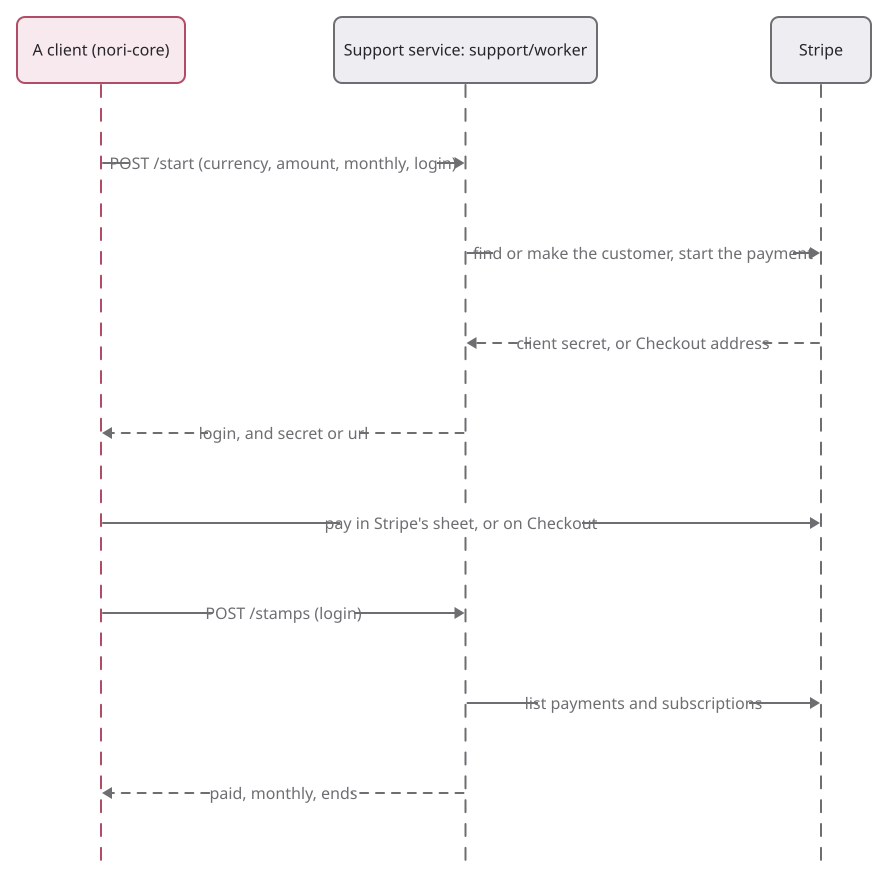

# Supporting nori

The Support page takes a payment to nori through Stripe, once or every month. It also shows a stamp book:
one seal for each payment that went through, in the accent of the season it was paid in. The page talks
to the support service, a Cloudflare Worker over Stripe in `support/worker`. The Worker also draws the
page in the browser at `https://support.norifm.com`. There a person supports nori without the app, and
stops monthly support with one tap. The Worker stores nothing. Stripe keeps every record.

<picture>
  <source media="(prefers-color-scheme: dark)" srcset="diagrams/support-payment-dark.svg">
  
</picture>

## The parts

- `crates/core/src/support.rs` decides what the page offers and talks to the service. It holds the
  currencies and their amounts, checks typed amounts, and makes the seals (`support_stamps`). `Client`
  makes the calls, such as `support_start` and `support_stop`.
- The `support` setting (`Supporter`) keeps what the app knows. That is its login, when it paid,
  whether a monthly payment runs, and when one set to stop ends. No settings page shows it, but a backup
  carries it.
- `crates/host/src/support.rs` serves the clients that pay in the browser. It writes money and currency
  names in English, picks the country a choice starts in, and starts a Checkout page (`checkout`).
- `support/worker/src/index.ts` is the whole service, its page included. `support/worker/wrangler.jsonc`
  configures its two deployments.
- `support/worker/src/offered.json` holds what the Worker's page looks up, so no rule is typed twice. It
  has the currencies and their amounts, the currency of each country and the first amount picked. It also
  has the day each season starts on either side of the equator, and each season's colors. The core writes it. A test in `crates/core/src/support.rs`
  (`the_worker_offers_what_the_core_does`) fails when the file is stale, and
  `NORI_BLESS=1 cargo test -p nori-core worker_offers` writes it again. Do not edit it by hand.
- Each client draws the page: Android's `SupportScreen.kt`, `web/src/pages/Support.svelte` over
  `crates/web/src/support.rs`, the iPod's `Support.swift` over `crates/ios/src/support.rs`,
  `crates/cli/src/support.rs`, and the desktop app.

Each currency offers five amounts for each cadence, then **Other** for a typed amount. A typed amount
must lie between the currency's least and most amounts. In a country with its own offered currency, the
page starts in that currency. In the euro area, it starts in euros, and anywhere else in US dollars.

A seal takes the season of its payment date, on the user's side of the equator. Each seal is turned by up
to 7 degrees. The turn comes from the payment time, so a payment looks the same on every client.

## What the service keeps

The Worker has no storage. It finds everything in Stripe:

- Each app is a Stripe customer. Its login is `<customer id>.<secret>`. The customer's `nori_key`
  metadata holds the SHA-256 of the secret, and the Worker checks the login against it.
- The first payment makes the customer and the login. The core saves the login in the `support` setting.
- A browser keeps its login in the `nori_login` cookie: `HttpOnly`, `Secure`, `SameSite=Lax`, for 400
  days. `POST /give` sets it. A cookie with a login Stripe does not know, or a wrong secret, is cleared, and
  the page shows what it shows a new visitor.
- When a payment carries an email address and the customer has none, the Worker copies it onto the
  customer. Stripe's receipts then reach it. Stripe sends a receipt only to an address it has when the
  payment goes through. The app's sheet gives the email only with the payment, so the first payment had no
  receipt. While the customer has no email, the Worker sets each payment's `receipt_email` on its charge,
  and Stripe then sends that payment's receipt. It does this the first time it lists the payments
  (`/stamps`, or the page). Stripe sends no receipts in test mode.
- Monthly payments are prices of one product, `nori-support`. The Worker makes it the first time it needs
  it.
- The customer portal has three configurations, `manage`, `stop` and `login`, known by their `nori`
  metadata. The Worker makes each the first time it needs it. `stop` and `login` can cancel a payment,
  at the end of the month paid for. `login` has Stripe's hosted sign-in page on: a person signs in with
  the email on their receipt and Stripe sends them a code. It is for an app that no longer has its login.

## The service's requests

The apps' requests are `POST`s with a JSON body, and the answers are JSON. The page's requests are
`GET /`, `GET /done` and form `POST`s, which the next section lists.

| Request | Body | Answer |
|---|---|---|
| `POST /start` | `currency`, `amount`, `monthly`, `login`, `in`, `season` | `login`, and `secret` or `url` |
| `POST /stamps` | `login` | `paid`, `monthly`, `ends` |
| `POST /manage` | `login` | `url` of Stripe's customer portal |
| `POST /stop` | `login`, `in: "app"` | `ends`, `months` |
| `POST /keep` | `login` | An empty object |
| `GET /done` | `paid=1&season=…` or `left=1` in the query | An HTML page |

`/start` takes the amount in minor units. Without a `login`, it makes a customer first. With
`in: "app"`, it starts a PaymentIntent for one payment, or an incomplete subscription for a monthly one.
The answer's `secret` is what Stripe's sheet or form in the app needs. With `in: "browser"`, it makes a
Checkout session and answers its `url`. `season` is the season the payment is stamped in, as the app
counts it.

`/stamps` lists every payment that went through and was not refunded. The list is in Unix seconds,
oldest first. The `monthly` field is true while a monthly payment runs and is not set to stop. The
`ends` field is when one set to stop ends, or null.

`/stop` sets the monthly payment to stop at the end of the month paid for. It answers when it ends and
how many months it paid for, counted from the paid invoices. A request without `in` gets Stripe's portal
page instead, for builds that do not send it.

`/keep` keeps a monthly payment that is set to stop.

`/done` is where Checkout and the portal send the browser back. After a payment, it stamps the seal of
that season and thanks you. If you left Checkout, it shows the seal's empty place. From the portal, it
shows only the way back to nori. After a payment from the page (`on=page`), it links back to the page.

A Checkout session turns off Stripe's Managed Payments (`managed_payments[enabled]=false`). An account
has it on by default, and then Checkout refuses a product without a tax code.

### When a request fails

| Status | `error` | Cause |
|---:|---|---|
| 401 | `login` | No login, an unknown one, or a wrong secret |
| 409 | `currency` | A monthly payment runs in another currency |
| 400 | `failed` | The body is not JSON, or a field is invalid |
| 404 | `failed` | No monthly payment to stop or keep |
| 502 | `failed` | Stripe refused the request |

A 409 comes from `/start`. Stripe holds a customer to one currency while a subscription is open. Before a
monthly payment starts, the Worker cancels the customer's unpaid subscriptions, for example from a sheet
closed before paying. A running one in another currency stops the start.

## The page

`GET /` is the apps' Support page in HTML, on the paper of the season, light or dark as the system is.
It shows the stamp book, then the amount, **Every month**, the currency and **Give**. The currency starts as
the visitor's country (`request.cf.country`), and a seal's season follows the visitor's side of the
equator (`request.cf.latitude`). With a known login in the cookie, the book holds the browser's payments.
While a monthly payment runs, the page shows its amount, **Card and receipts** and **Stop**, in Spring's
rose. While one is set to stop, it shows when it ends and **Keep going**. A row links the `login`
configuration's sign-in page, for support paid in the app.

The page works without scripts. CSS shows the amounts of the cadence chosen and the words on **Give**. A
changed currency reloads the page with the choice in the query. A script does it on change, and without
scripts a **Change currency** button does.

The page's forms post to these requests:

| Request | Form fields | Answer |
|---|---|---|
| `POST /give` | `currency`, `every=month` or none, `once` and `month` (an index or `other`), `other` | 303 to Checkout, with the login cookie |
| `POST /monthly/stop` | None | 303 to the page |
| `POST /monthly/keep` | None | 303 to the page |
| `POST /monthly/card` | None | 303 to Stripe's portal, which returns to the page |

`/give` makes the payment as `/start` with `in: "browser"` does, with the cookie's login or a new one.
Checkout returns to `/done`, or to the page when you leave it. A typed amount outside the currency's least
and most, or a refused start, shows the page again with the reason. `/monthly/stop` and `/monthly/keep` are
`/stop` with `in: "app"` and `/keep`.

Each form `POST` must carry an `Origin` header equal to the Worker's own origin, or it gets 403. With
`SameSite=Lax` on the cookie, this stops another site's form from acting with a visitor's login.

## How each client pays

Each client pays in one of two ways. The core's `PayIn` says which one.

| Client | Pays in | After paying |
|---|---|---|
| Android | Stripe's PaymentSheet (`paymentsheet`), with Google Pay | Asks when the sheet completes |
| The web | Stripe's Payment Element under an email field (the Link Authentication Element), in a sheet | A bank's page returns to `#/support/paid` |
| The desktop app | Checkout in the browser | Asks again when the app is in focus |
| The terminal app | Checkout in the browser, with the link and a QR code | Asks again when the app is in focus |
| The iPod app | Checkout in Safari, with a QR code to pay from a phone | Asks again when the app is in focus |

The iPod shows the QR code because iOS 12's Safari might be too old for Checkout.

Every client asks for the email. Android's sheet always collects it (`BillingDetailsCollectionConfiguration`),
and Checkout asks while the customer has none. The Payment Element asks only for some methods. So the web
client puts an email field above it, and passes the email as the payment's billing email.

While a monthly payment runs or is set to stop, the page offers **Stop**, in Spring's rose, or **Keep
going**. These call the core's `support_stop` and `support_keep`, and the settings keep the end date
(`Supporter::ends`).

A client asks the service only while the Support page is open, so the thanks never plays on another
screen. When the page gets seals it did not show when it opened, it thanks you for the newest one.

## Give a build its Support page

A build has a Support page only when its Rust build gets two environment variables:

- `NORI_SUPPORT_URL`, the Worker's address.
- `NORI_STRIPE_KEY`, Stripe's publishable key.

Without them, `support_service()` returns `None`, and no client shows the page. A `pk_test_` key selects
Stripe's test mode and Google Pay's test environment.

CI takes both from the repository variables of the same names. The nightly, release, host release and web
workflows put them into every build. `tools/ipod.sh` and `tools/host-release/build.py` pass them into
Docker. Each workflow fails at its first step when either variable is empty, so no published build lacks
the page. Gradle lists both as inputs of the Rust build, so it rebuilds the core when they change.

## Deploy the service

The same code runs twice:

- `nori-support` uses Stripe's test mode, for development.
- `nori-support-live` uses live mode. It answers at `https://support.norifm.com`, the address in the
  repository variable.

To deploy, run Wrangler from the Worker's folder:

1. Go to the folder with `cd support/worker`.
2. Run `npx wrangler@4 deploy`. Add `--env live` for the live deployment.
3. The first time, set its Stripe key with `npx wrangler@4 secret put STRIPE_SECRET`. Use the same
   `--env`.

The live key is a restricted key. It has write access to Customers, PaymentIntents, Products, Checkout
Sessions, Customer portal, Prices, Subscriptions and Charges (to send a first payment's receipt). It has
read access to Invoices, and no other access.

## Try it

1. Build with the test deployment's address and a `pk_test_` key.
2. Pay with Stripe's test card `4242 4242 4242 4242`, with any future date and any CVC.

To try the page without deploying, run it on your computer from `support/worker`. Put
`STRIPE_SECRET=sk_test_…` in a file outside the repository and run
`npx wrangler@4 dev --local --env="" --env-file <file>`. Then open `http://127.0.0.1:8787/`.

To set the stamp book directly on an Android debug build, use the test bridge:

```sh
tools/app.sh set support '{"login":"","paid":[1775822400],"monthly":false}'
```
